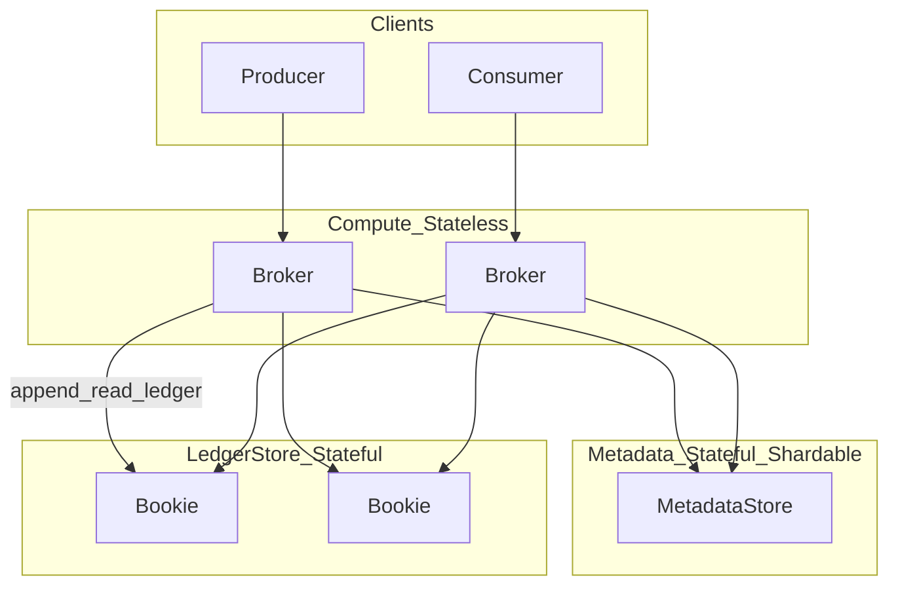
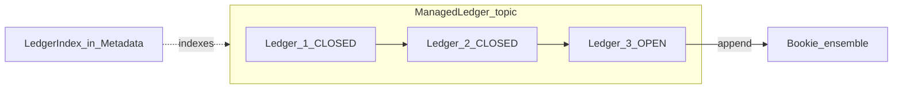
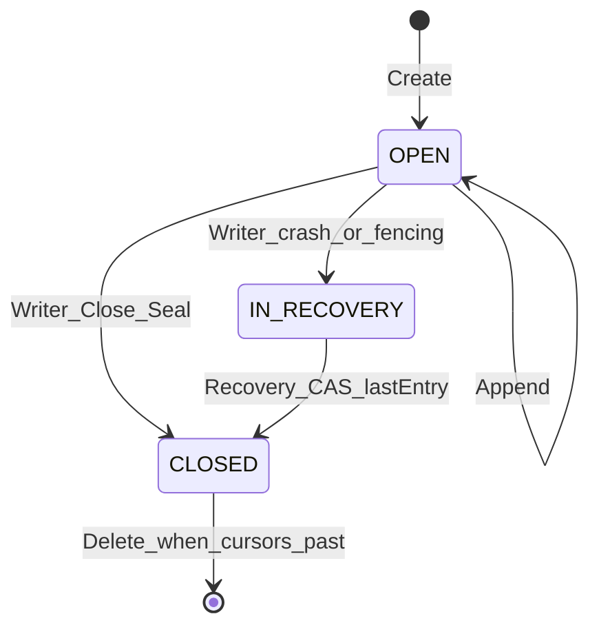
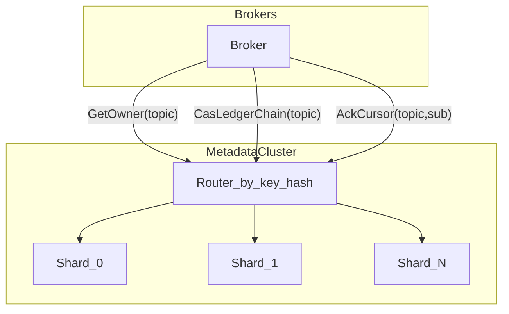
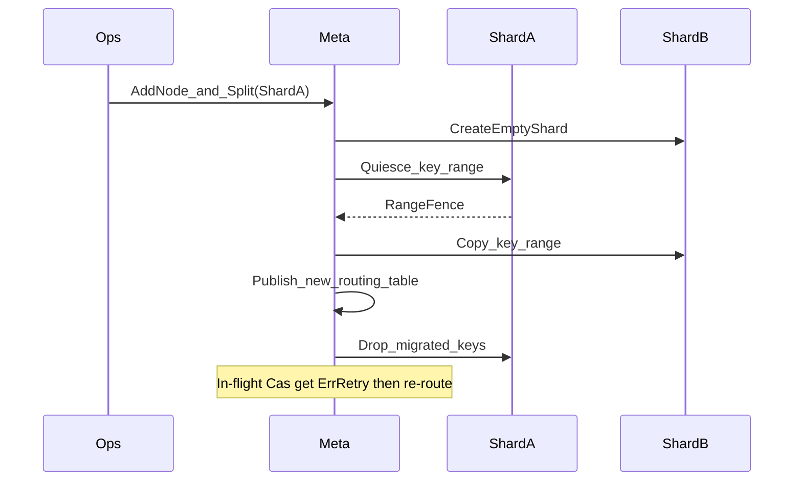
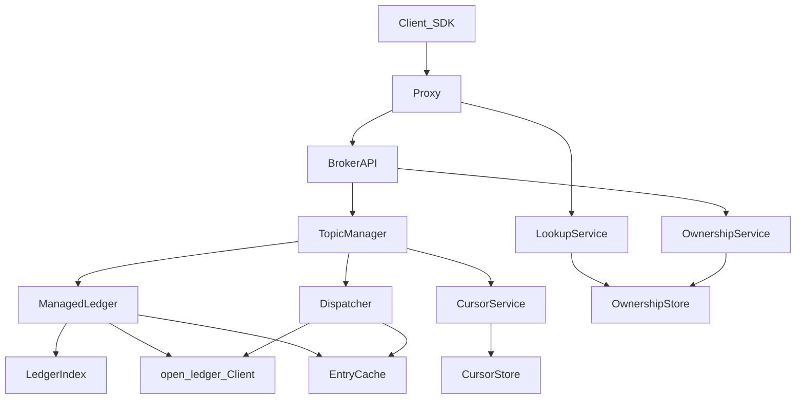
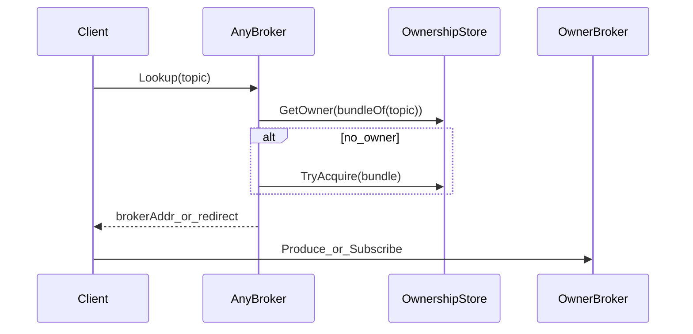
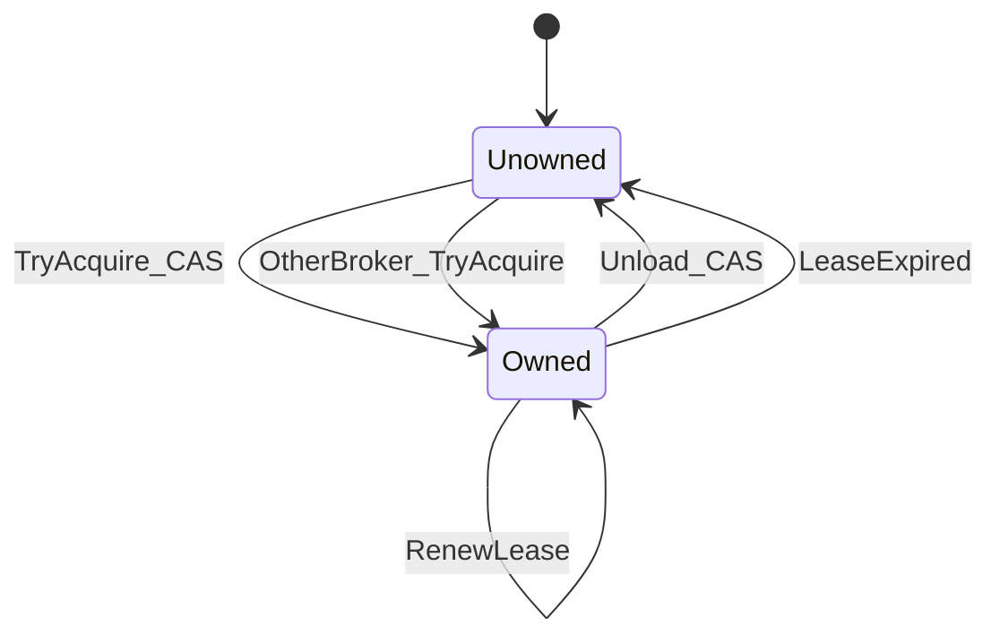
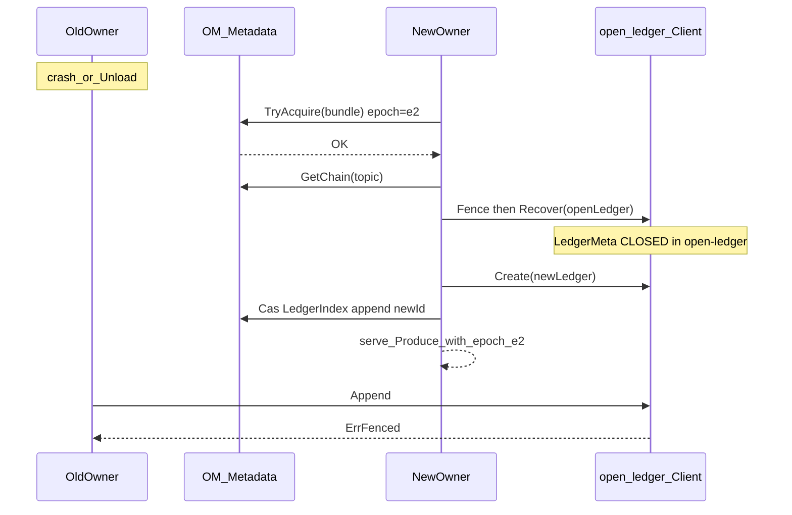

# open-message 架构设计文档

**文档层属 L2（架构总览）。** 总入口与分层阅读：[README.md](./README.md)；组织规则：[STRUCTURE.md](./STRUCTURE.md)。  
先读 L1（[design/00](./design/00-principles.md) / [34](./design/34-architecture-goals.md) / [37](./design/37-design-rationale.md)），细节进 L3 细章；本文件保持摘要与指针。

## 1. 目标与交付范围

### 1.1 目标

落实 Pulsar 式**存算分离**，并同时兑现四条架构合同（权威细述 [`design/34`](./design/34-architecture-goals.md)）：

| 合同 | 含义（摘要） |
|---|---|
| **高可用** | 单点故障 L0–L2 自愈；计划内 Drain 近无感；崩溃窗可自动收敛 |
| **高并发** | Broker / Meta shard / Bookie / 分区水平扩展抬并行度；**不搬历史消息体** |
| **强数据一致性** | 已 Receipt 耐久（Qa）；Ownership 线性化至多一主；Fence+Recover 尾唯一；禁止双主分叉 |
| **故障/运维对用户无感** | 应用默认靠 Proxy+SDK 重试/幂等消化变更与切主；**无感≠零错误帧≠假 exactly-once** |

并满足：

1. **Broker 对消息数据无状态**：不在本地持久化消息体；failover / 扩容只迁 ownership。
2. **消息元数据有状态且外置、可分片**：ownership、账本索引、cursor 在 Metadata Store；**加分片以提升异 key 并发**（§5）。
3. **主存采用 Pulsar/BookKeeper 账本模型**：append-only Ledger + Ensemble/WriteQuorum/AckQuorum；对象存储作 **已关闭账本** 的冷层（offload 必做，见分期）。
4. **三面均可在线水平扩容**：Broker / Metadata / Ledger（Bookie）加节点不中断服务；**不把搬迁历史消息体作为扩容前提**。
5. **生产接入默认经 Proxy**：Client 只连统一入口；Proxy 无持久消息状态，转发到 bundle owner（见 [design/14-proxy.md](./design/14-proxy.md)）。
6. **可用性双阶段均交付**：阶段一（优雅切主、重试、幂等、租约、滚本）+ 阶段二 **Warm Standby**（[15](./design/15-availability-failover-window.md) / [16](./design/16-warm-standby.md)）；顺序上先阶段一达标再开热备，**不是砍掉热备**。
7. **常规消费分发全做**：多订阅 pub-sub + Exclusive / Failover / Shared / Key_Shared（[18](./design/18-dispatch-modes.md)）。
8. **耐久闭环全做**：多副本写 + **open-ledger AutoRecovery**；业务 **Metadata 默认 Oxia，并支持 OpenKV**（[design/02 §9](./design/02-metadata.md)）；账本 Meta 不进 Broker（[design/19](./design/19-open-ledger-integration.md)）。

### 1.2 交付原则（已定）

- **`docs/design/*` 已定能力全部落地**，没有「设计了但不做 / 可选砍掉」。
- 只允许 **按里程碑分期**（M0→M3…），不允许用「非目标」裁掉细章。
- M1 可用直连调试 Broker，但 **Proxy、四订阅模式、AutoRecovery、Warm Standby、冷层 offload** 均在总交付清单内，按计划实现。
- 架构约束（仍须遵守，不是「不做功能」）：单 partition 单 writer；消息体不落 Broker 盘；主写不是对象存储。

一句话：**设计范围内的能力都要做；分期是顺序，不是范围缩减。**

**架构四目标（高可用 / 高并发 / 强一致 / 用户无感）** → [`docs/design/34-architecture-goals.md`](./design/34-architecture-goals.md)。  
**组件角色与职能（每个角色做什么/不做什么）** → [`docs/design/35-component-roles.md`](./design/35-component-roles.md)。  
**六角生产级工作标准** → [`docs/design/36-production-grade-bar.md`](./design/36-production-grade-bar.md)。  
**设计合理性说明（角色/流程/组件/功能强制）** → [`docs/design/37-design-rationale.md`](./design/37-design-rationale.md)。  
**细化设计（合理 / 故障自愈 / 可扩容）** 见目录 [`docs/design/`](./design/00-principles.md)：每块含动机、模型、正常路径、故障矩阵、扩容、不变量、阶段。主文档保留总览与摘要；**评审以 `docs/design/*` 细章为准。**

**端到端流程与设计图总册**（Produce/Consume/Proxy/切主/热备/扩缩/Orphan/Offload/双 Meta/用户无感）→ [`docs/design/13-flows-and-diagrams.md`](./design/13-flows-and-diagrams.md)。  
**Proxy** → [`docs/design/14-proxy.md`](./design/14-proxy.md)。  
**Broker 挂掉为何会短暂报错、如何缓解** → [`docs/design/15-availability-failover-window.md`](./design/15-availability-failover-window.md)。  
**Warm Standby 热备切主** → [`docs/design/16-warm-standby.md`](./design/16-warm-standby.md)。  
**主存 vs BookKeeper 差异** → [`docs/design/17-storage-vs-bookkeeper.md`](./design/17-storage-vs-bookkeeper.md)；实现仓 **[open-ledger](../../open-ledger/)**（Rust）。  
**权责（已定）**：账本元数据 / AR 由 open-ledger 自管；Broker 只管业务 Meta → [`design/19`](./design/19-open-ledger-integration.md)。  
**集成契约**（ledgerId / ensemble / 错误码）→ [`design/20`](./design/20-broker-openledger-contract.md)。  
**线协议帧格式** → [`design/21`](./design/21-wire-protocol.md)。  
**消费分发模式**（Exclusive / Failover / Shared / Key_Shared / 多订阅 pub-sub）→ [`docs/design/18-dispatch-modes.md`](./design/18-dispatch-modes.md)。  
**测试 / 运维门禁** → [`design/31`](./design/31-test-strategy.md) · [`design/32`](./design/32-operations.md) · [`ops/`](./ops/README.md)。  
**运维规格（安装 / 部署 / 扩缩 / 演练 / 观测 / 恢复）** → [`docs/design/32-operations.md`](./design/32-operations.md)；手册 [`docs/ops/`](./ops/README.md)。  
**客户使用说明** → [`docs/design/33-customer-usage.md`](./design/33-customer-usage.md)；用户文档 [`docs/user/`](./user/README.md)。  
**本地 K8s 测试部署（hostPath CSI）** → [`docs/deploy/local-k8s.md`](./deploy/local-k8s.md)。

### 1.3 术语对照（与 Pulsar 对齐）

| open-message / 本文 | Pulsar / BookKeeper |
|---|---|
| Ledger（账本） | BookKeeper Ledger |
| Bookie / LedgerNode | Bookie |
| ManagedLedger | Managed Ledger（一个 topic 的逻辑日志） |
| Ledger 链 / LedgerIndex | ML 持有的 ledger **id** 列表（单本详情在 open-ledger） |
| Ensemble / W / A | Ensemble size E、Write Quorum Qw、Ack Quorum Qa |
| LAC | LastAddConfirmed |
| Fence + Recovery | Ledger fencing & recovery |
| OffloadLocation | 已 seal ledger 的冷层 URI（存在 **open-ledger LedgerMeta**） |

下文「Segment」若出现，均指 **已关闭（CLOSED）的 Ledger** 在冷热分层语境下的别名；热路径统一称 **Ledger**。

---

## 2. 总览



| 面 | 状态性质 | 持有 | 不持有 |
|---|---|---|---|
| **Broker** | 服务态可丢 | 热缓存、连接、permits、inflight | 消息体、权威 cursor、权威 ledger 列表 |
| **Metadata** | 有状态、可分片 | ownership、ManagedLedger→ledger 链、cursor、节点注册 | 消息 payload |
| **LedgerStore（Bookie）** | 有状态、耐久 | 账本 entry 字节（journal + ledger 存储） | 路由与租户策略 |

**Broker「无状态」的准确含义**（易误解，这里钉死）：

- Broker **有运行时状态，但主要在内存**（软状态）：连接、EntryCache、当前 OPEN ledger 句柄与 LAC、未刷盘 cursor、持有的 bundle epoch、Dispatcher 队列等。  
- Broker **没有**「必须落在本机磁盘、迁走就要搬文件」的消息权威状态；权威在 **Metadata + Bookie**。  
- 因此杀进程 = 内存状态丢光 → 新 Owner **重建**内存视图，**不搬账本数据**；不是「进程里空空如也、任意节点瞬时对等」。

---

## 3. 主存选型

| 维度 | BK 账本主存（**选定主写**） | 对象存储（**仅 CLOSED 冷层 offload，不做主写**） |
|---|---|---|
| Produce 延迟 | Journal 落盘，毫秒级可达 | 对象 RTT 更高 |
| 排序 | 契合 owner single-writer + 单 ledger writer | 易逼向 leaderless |
| 元数据 | Meta 存 ledger 链；BK 存 ledger metadata/fragments | Meta 常要扛 sequencer |
| 扩容 | 加 bookie，**新 ledger** 打到新节点，不搬历史 | 另一套系统 |

热路径：**禁止 Produce 直写对象存储**。仅 **CLOSED** 账本可 offload；`OffloadLocation` 挂在 **open-ledger LedgerMeta**（本仓 Index **不存**）。

---

## 4. 账本（Ledger）设计 — 对标 Pulsar/BookKeeper

这是存储层的核心。open-message 的耐久单元不是「Broker 本地 partition 文件」，而是 **BookKeeper 语义的 Ledger**。

### 4.1 账本是什么

Ledger 是：

- **Append-only** 的有序 entry 序列
- **Single-writer / multi-reader（SWMR）**
- 写入时复制到一组 Bookie（ensemble）
- 关闭（close/seal）后 **不可变**，只能读或整本删除
- 故障后通过 **fencing + recovery** 收敛出唯一尾部，再交给新 writer 开**新** ledger 续写

一条 topic 的逻辑日志 = **ManagedLedger** = 随时间滚动的 **Ledger 链**（不是单个无限增长文件）。



### 4.2 账本元数据（必须持久）

每个 Ledger 的元数据由 **open-ledger 自管**（Broker 不写）；形状对齐 BK：

| 字段 | 含义 |
|---|---|
| `ledgerId` | 集群内唯一 ID |
| `E` | Ensemble size：账本候选 bookie 数 |
| `Qw` | Write Quorum：每条 entry 实际写入的 bookie 数 |
| `Qa` | Ack Quorum：确认前需成功落盘的副本数；约束 `E ≥ Qw ≥ Qa` |
| `state` | `OPEN` / `IN_RECOVERY` / `CLOSED` |
| `lastEntryId` | `CLOSED` 后确定的最后一条；未关闭则为未定 |
| `fragments[]` | 每个 fragment：`firstEntryId` + 当时的 ensemble（bookie 列表） |
| `OffloadLocation?` | 冷层对象位置（仅 CLOSED；首期空） |

**Fragment**：ensemble 变更（某 bookie 写失败被替换）时追加新 fragment，**不改写历史 fragment**。一个 ledger 可有多段 ensemble，但每条 entry 只属于一个 fragment。

### 4.3 Ensemble / Write Quorum / Ack Quorum

对 entry `i`，Write Quorum 取当前 fragment ensemble 上从下标 `i % E` 起连续 `Qw` 个 bookie（round-robin striping）。

- Writer **并行**向这 `Qw` 个 bookie 发送**完整** entry（不是拆条带、也不是主备串行双写）
- 收到任意 `Qa` 个 durable ack，且更小 entryId 均已确认 → 向上确认，推进 **LAC（LastAddConfirmed）**
- 耐久能力：可容忍 `Qa - 1` 个 bookie 故障而不丢**已确认**数据

| 配置直觉 | 含义 |
|---|---|
| `Qa = 1` | 单副本确认即返回；吞吐高，丢盘风险大 |
| `Qa ≥ 2` | 至少双副本确认更稳 |
| `E == Qw` | 无 striping，可做 sticky read |
| `E > Qw` | entry 在 ensemble 上轮转，打散 I/O |

首期嵌入式实现允许 `E=Qw=Qa=1`，但 **API 与元数据必须带 E/Qw/Qa**，避免以后破界面。

### 4.4 Entry 内容与 LAC

写入 bookie 的 entry 至少包含：

- `ledgerId`, `entryId`
- `lastAddConfirmed`（写本条时已向客户端确认的最大 entryId）
- `payload`（消息字节；可含 batch）

规则：

- 读者安全可读范围：`entryId ≤ LAC`
- LAC 之后的数据可能只存在于部分 bookie，**recovery 前不能当已提交**

`MessageID`（对外）= `(ledgerId, entryId[, batchIndex])`。

### 4.5 账本生命周期



| 阶段 | 行为 |
|---|---|
| **Create** | **open-ledger Client** 发号 + 选 ensemble，写 OL LedgerMeta=`OPEN`；ML 再 Cas **LedgerIndex** 挂链尾 |
| **Append** | 唯一 writer 经 Client 追加；并行 Qw、等 Qa；更新内存 LAC |
| **Close/Seal（正常）** | Client Close → OL LedgerMeta `CLOSED`+lastEntryId；之后只读 |
| **Fence + Recovery（故障）** | Client Fence/Recover → OL Meta 钉尾；见下节 |
| **Delete** | cursor 越过且 retention 允许后：Index 摘链 + Client.Delete（OL） |

**为何滚动多个 ledger**：  
1）故障后旧 ledger 只能关闭，必须开新本续写；  
2）按大小/时间滚动便于删除与 offload；  
3）整本删除比在巨型文件中间打洞简单。

### 4.6 Fencing 与 Recovery（对标 BK 协议）

Owner 切换或 writer 崩溃时，新 writer **不能**直接往旧 OPEN ledger 追加，必须：

以上步骤均由 **open-ledger Client** 对 **OL LedgerMeta + Bookie** 执行（Broker 不直接 CAS 账本 Meta）：

1. OL Meta CAS → `IN_RECOVERY`
2. **Fence** bookie；覆盖 `(Qw-Qa)+1` 后旧 writer 凑不齐 Qa → `LedgerFenced`（视同超时）
3. **Recovery** 读修尾部至 Qw
4. OL Meta CAS → `CLOSED` + `lastEntryId`
5. Client.**Create** 新本；ManagedLedger **Cas LedgerIndex** 挂新 id 后继续写

这保证：读者见相同账本尾；单 writer 失败不叉日志。

### 4.7 Bookie 内部：Journal 与 Ledger 存储

对标 BookKeeper bookie 的盘布局（嵌入式可简化，语义保留）：

| 区域 | 作用 |
|---|---|
| **Journal** | 写路径 WAL；entry 先入 journal 落盘再 ack；低延迟盘 |
| **Ledger storage** | 长期 entry 数据；可与 journal 分盘，避免 catch-up 读拖尾写 |

Bookie **无 topic 概念**：只认 `ledgerId + entryId`。Topic/订阅/归属全部在 Broker + Metadata。

### 4.8 ManagedLedger 如何用账本

ManagedLedger（Broker 内编排，权威索引在 Metadata）：

1. 打开 topic → 读 `LedgerIndex`（ledger 链）
2. 若链尾是 `OPEN` 且本节点是新 owner → 先 Recovery 关掉，再开新 ledger
3. Produce → 写入当前 `OPEN` ledger；满员/定时/切换 → Close 当前 + Create 下一个，**CAS 更新链**
4. Read → 按 MessageID 定位到某 ledger，再 `LedgerStore.Read`
5. Trim → cursor 全部越过的前缀 `CLOSED` ledger 可 Delete

Cursor 持久化在 Metadata（或独立 cursor ledger，首期 CursorStore 即可）；**不把消费位点只放在 Broker 内存**。

### 4.9 与冷层的关系

- 只有 **CLOSED** ledger 可 offload（不可变）
- Offload 后更新 **open-ledger** `LedgerMeta.OffloadLocation`，延迟删 bookie 本地副本  
- 读路径：由 open-ledger / Client 见 OffloadLocation 后回源；M3 实装上传

---

## 5. 元数据组件设计（可分片 · 高并发）

元数据是**有状态**面，也是最容易变成全局瓶颈的面。设计目标：

1. **正确性**：ownership / ledger 链 / cursor 的 CAS 语义不丢、不双主。  
2. **扩容抬并发**：加 metadata 节点后，**互不相关的 key 上的读写并行度近似线性上升**。  
3. **热路径短**：Lookup（查 owner）不能依赖全集群协商或全表扫描。

反模式（明确禁止）：把所有元数据塞进「固定小 quorum、全局串行」的单协调集群当终态（经典 ZK 单 ensemble 扛千万 key 的模型）。接口与分片形态按 **可水平扩展的分片 KV + 每 key 条件更新** 设计（精神对齐 Oxia / 分片 Meta，而非 ZK 目录树）。

### 5.1 逻辑子系统与分片键

所有 API **必须携带 partition key**；路由只依赖 key，禁止「先 list 再找」。

| 子系统 | 存什么 | Partition Key | 并发特征 |
|---|---|---|---|
| **OwnershipStore** | topic/bundle → `{brokerID, epoch, leaseExpire}` | `bundleID`（首期可=topic） | Lookup 读极热；Acquire/Unload 写较少但要强一致 |
| **LedgerIndex** | topic → 有序 `ledgerId[]` + `openLedgerId`（**仅 id 链**） | `topic` | 滚本时 Cas；账本详情不在此 |
| **CursorStore** | `(topic, sub) → position(ledgerId, entryId)` | `topic`（二级 `sub`） | 合并刷盘；Shared 后 individual 更高 |
| **NodeStore** | **仅 broker** 注册、地址 | 全局小表 | Bookie 注册在 **open-ledger** |
| **SchemaStore**（占位） | schema version | `topic` | 冷 |

单本 **LedgerMeta / AutoRecovery / bookie registry** → **open-ledger Metadata**（Broker 不写）。见 [design/19](./design/19-open-ledger-integration.md)。

**Ledger 数据（payload）不进 Metadata**——只进 LedgerStore。Metadata 只做 index/data split 里的 **index**。



### 5.2 分片与路由

- **哈希环 / 固定 hash 槽**：`shard = hash(partitionKey) % numShards`（或 consistent hashing + 虚拟节点）。  
- **在线分裂**：热点或容量触发时，一个 shard 的 key range / 槽位集合 split 到新节点；迁移期间允许：
  - **双读**：先新后旧或先旧后新，以版本戳为准；  
  - **写阻断极短**：仅迁移中的 key 返回 `ErrRetry` / `ErrShardMoving`，Broker/Client 重试。  
- **禁止**：迁移时停整个 Metadata 集群；禁止为扩容做全量导出导入停机窗。

扩容与并发的关系：

| 动作 | 对并发的影响 |
|---|---|
| 增加 shard 数（加节点并 split） | 不同 key 的 CAS/Get **并行度 ↑**（锁/raft 组变多） |
| 仅给单 shard 加从副本 | **读**并发 ↑，写仍受该 raft 组 leader 限制 |
| 不加 shard 只加机器共主 | **几乎不提高写并发**（仍单 leader 串行） |

因此：**要支撑更高并发，扩容主路径是加分片（scale-out shards），不是给单分片堆从库。**

### 5.3 单分片内的一致性与并发模型

每个 shard 是一个独立一致性域（建议每 shard 一组复制状态机 / Raft-like；嵌入式可用互斥锁模拟）：

| 能力 | 约定 |
|---|---|
| **按 key 的 CAS** | `Cas(key, expectVersion, newValue) → (ok, current)`；Ownership / LedgerIndex / Cursor 一律版本号 |
| **同 key 串行** | 同一 partition key 上的写线性化（保证单 owner、账本链不分叉） |
| **异 key 并行** | 分片内不同 key 可并行（多 raft 组更佳；单组内也可 batch 提交但语义仍 per-key） |
| **读** | 强读走 leader；允许 `GetOwner` 用 **租约内本地缓存**（见下）降 Meta QPS |

不提供跨多个 topic 的分布式事务（首期）。需要原子性的操作收窄到 **单 key**（一条 ownership、一条 ledger 链、一个 cursor）。

### 5.4 热路径：Lookup 与写放大控制

Produce/Consume 每次都打 Metadata 会先打爆 Meta。约定：

1. **Broker 侧 Owner 缓存**：`topic → (brokerID, epoch, expireAt)`，TTL / 租约心跳刷新。  
2. Lookup 仅在缓存未命中、redirect、或 produce 收到 `NotOwner/Fenced` 时访问 OwnershipStore。  
3. **LedgerIndex 缓存在 owner Broker 内存**：权威仍在 Meta；滚账本时 CAS 成功后再改本地视图。  
4. Cursor：**合并刷盘（已定）**——禁止默认每 ack 同步写 Meta；按时间/条数窗口或 Unload 前强制 flush（见 [design/02 §7](./design/02-metadata.md)）。  
5. **读写分离**：Ownership 的 Get 可由 follower 服务（可稍旧），Acquire 必须 leader；客户端容忍短时旧读 + redirect（M3+ 与 Standby 同轨）。

并发预算直觉（设计约束，非实现数字）：

- Meta 写 QPS ≈ `O(滚账本频率 + ownership 变更 + cursor 刷盘频率)`，**不应** ≈ `O(消息 QPS)`。  
- Meta 读 QPS ≈ `O(lookup 未命中 + 恢复/管理)`，靠缓存压到远低于消息 QPS。

### 5.5 各子系统操作语义

#### OwnershipStore

```text
GetOwner(key) -> (brokerID, epoch, version)
TryAcquire(key, brokerID, lease) -> CAS: 空闲或租约过期或同 broker 续约则成功，epoch++
Unload(key, brokerID, epoch) -> CAS: 仅当前 epoch 持有者可释放
```

- **fencing token** = `epoch`：Broker 写账本/服务请求时携带；过期 epoch 拒绝。  
- 租约到期未续约 → 他者可 Acquire（支撑宕机 failover）。  
- 并发：不同 bundle 的 Acquire 落在不同 shard → 并行；同 bundle 串行 CAS → 防双主。

#### LedgerIndex

```text
GetChain(topic) -> (ledgers[], version)
CasAppendLedger(topic, expectVer, newLedgerId) -> 链尾追加（open-ledger Create 已成功之后）
```

- **滚本**：先 open-ledger Close/Recover + Create，再 **一次 Cas LedgerIndex** 挂新 id（见 [design/02 §3.1](./design/02-metadata.md)、[design/19](./design/19-open-ledger-integration.md)）。  
- Index **只存 ledgerId**；ensemble/state 权威在 open-ledger。Create 成功但 Index Cas 失败 → orphan，由 open-ledger GC。

#### CursorStore

```text
Get(topic, sub) -> CursorValue, version
CasAdvance(topic, sub, expectVer, newValue) ->
  Exclusive/Failover: markDelete 仅允许前移（cumulative）
  Shared/Key_Shared: 原子写入 {markDelete, individualAcks}；
                     markDelete 不得跳过仍在 individualAcks 中的空洞（见 design/04、18）
```

- 分片在 `topic`，同一 topic 多 sub 同 shard，便于日后「按 topic 删前缀账本」扫描同片 cursor（仍禁止集群全扫）。  
- Unload 必须刷整份 CursorValue。  
- 更高并发：cursor 刷盘与消息路径解耦（异步），崩溃窗口用 at-least-once 接受。

#### NodeStore

- **仅 Broker** 注册、心跳；变更少。Bookie 注册在 **open-ledger**。  
- 可强一致单分片；GetAll 仅管理面使用，不在 produce 热路径。

### 5.6 扩容操作手册（设计层）



验收直觉：

- Split 过程中，**未迁移 key** 的 Get/Cas 延迟与成功率不明显恶化。  
- 迁移 key 短暂 `ErrRetry`，Broker 重试成功。  
- Split 完成后，对 **随机均匀 key** 的 Cas 吞吐随 shard 数近似上升（证明扩容提高并发）。

### 5.7 与账本面的边界

| 数据 | 位置 |
|---|---|
| entry payload、journal | open-ledger Bookie |
| 单本 state、ensemble、OffloadLocation | **open-ledger** LedgerMeta |
| topic→ledger **id 链** | open-message LedgerIndex |
| LAC 热值 | Owner Broker 内存；钉尾写入 open-ledger Meta |
| cursor | open-message CursorStore |

Broker **不得**在本地磁盘维护权威 Ownership / LedgerIndex / Cursor；**不得**写 open-ledger 的 LedgerMeta key。

### 5.8 首期与演进

| 阶段 | Metadata 形态 | 仍必须遵守 |
|---|---|---|
| 单测 | 进程内 map + per-key version | 全 API 带 partition key；无全表 Lookup |
| **默认（已定）** | **Apache Oxia** + 本仓适配层 | Cas；加分片抬异 key 并发；Lookup 缓存 |
| **可选（已定）** | **OpenKV** + 同适配层 | `METADATA_BACKEND=openkv`；PutCAS ↔ Cas |
| 不做 | ZK 单 ensemble 作为终态容量方案 | — |

---

## 6. 三面在线扩容

「无限」含义：吞吐/容量随节点近似水平扩展；**没有必须搬历史消息体的步骤**；Metadata 按 §5 分片扩展。

### 6.1 Broker

- 新 broker 注册 → Unload 部分 ownership → 新节点 Acquire  
- **只迁 ownership + 内存**；账本数据不动  
- 并行度不够时先加逻辑分区/bundle（元数据操作）

### 6.2 LedgerStore / Bookie

- 新 bookie 加入 ensemble **候选池**  
- **默认不搬历史 ledger**；**新 Create 的 ledger** 可选中新 bookie  
- 单 OPEN ledger 的写仍受其 ensemble 成员容量限制 → 靠 **Close + 新 ledger** 把后续写打散  
- 副本修复（AutoRecovery）不是扩容前提，但是 **耐久闭环必做（M3）**；M1 可先 `E=Qw=Qa=1`，M2 起真 quorum

### 6.3 Metadata

详见 **§5**。要点：加分片提高异 key 并发；加从副本主要提读；Lookup/cursor 不得与消息 QPS 同量级打满 Meta。

### 6.4 扩容不变量

1. 同一 topic 任意时刻至多一个写 owner；同一 OPEN ledger 至多一个 writer  
2. 扩 broker 从 CursorStore + LedgerIndex 恢复，不丢位点  
3. 已 CLOSED ledger 的 ensemble 不变即可读  
4. Meta 分片迁移时 Lookup/Cas 可重试  
5. **禁止**把「搬历史账本数据」当作扩容必经路径  

---

## 7. 组件职责详单

**权威细册（每个角色的职能 / 做·不做 / 权威状态 / 协作）** → [`design/35-component-roles.md`](./design/35-component-roles.md)。  
下文为摘要；与 35 冲突时以 35 + 相关细章不变量为准。



| 组件 | 做 | 不做 | 权威状态 |
|---|---|---|---|
| **Client SDK** | Lookup、Produce、Subscribe、Ack、默认可重试 | 运维集群；依赖内部 Meta 键 | 无 |
| **Proxy** | 统一入口、转发、Lookup 缓存 | 赋序、持久消息 | 无 |
| **LookupService** | 查 owner / redirect | 绕过 CAS「分配」ownership | 读 OwnershipStore |
| **BrokerAPI** | 校验 owner，解帧 | 权威存消息/cursor | 软状态 |
| **OwnershipService** | Acquire / Unload / Promote / epoch | 搬账本、改 cursor | OwnershipStore |
| **TopicManager** | 懒加载 ML/Dispatcher；unload | 存储复制 | 内存 runtime |
| **ManagedLedger** | 赋序、滚本；调 OL Client；Cas LedgerIndex | 写 LedgerMeta、跑 AR | 链在 OM；entry+LedgerMeta 在 OL |
| **open-ledger Client** | Create/Append/Fence/Recover/Close/Read | 自管业务 Ownership/Cursor | 经其写 OL Meta |
| **LedgerIndex** | topic→ledger **id** 链 CAS | 存 payload / ensemble / OffloadLocation | OM Metadata |
| **CursorService** | 订阅、ack、恢复、刷盘 | 消息体；Standby 覆盖权威 | CursorStore |
| **Dispatcher** | 四模式分发（[18](./design/18-dispatch-modes.md)） | 持久化 | 内存 |
| **EntryCache** | tailing 加速 | 当权威 | 可丢 |
| **Owner / Standby** | 单写 / 热备预热 | 双主成功写；跳过 Fence | 见 [35](./design/35-component-roles.md) §2 |
| **Bookie / AR** | 存字节 / 补副本 | 解释 topic；写 OM Meta | OL |
| **MetadataStore** | 分片 KV；Oxia/OpenKV；异 key Cas | 存消息；全表扫描 Lookup | Oxia 或 OpenKV |
| **Admin / LoadManager** | Unload、策略、半自动迁主 | 绕过 CAS 假迁主；搬历史消息体 | 见 25 / 05 / 35 §6 |

产品边界外 / 远期另章：Functions、IO、SQL、跨 topic 事务、Geo。  
下列为 **分期交付（非砍项）**：LoadManager **半自动（M2 退出条件）** / 自动 split（M3）、open-ledger AutoRecovery 集成验收、Tiered offload、双 Meta 对账（[design/27](./design/27-dual-meta-ops.md)）。  
**Proxy：生产默认入口，必做；M1 可用直连调试，M2 落地进程**（[14-proxy.md](./design/14-proxy.md)）。

---

## 8. 状态分类

### 8.1 必须持久

**open-message Metadata：**

- topic/bundle → owner + epoch  
- topic → **LedgerIndex**（仅 `ledgerIds[]` + `openLedgerId`）  
- topic+subscription → cursor  
- broker 注册  

**open-ledger Metadata（Broker 不写）：**

- 单本 LedgerMeta（含 E/Qw/Qa、state、fragments、lastEntryId、**OffloadLocation**）  
- bookie 注册 / AR 队列  

### 8.2 Broker 软状态（可丢）

- EntryCache、连接、permits、inflight、当前 OPEN ledger 句柄与内存 LAC（以 recovery 为准）  
- Owner / LedgerIndex 的本地缓存（以 Metadata CAS 版本为准）

---

## 9. 关键路径

### 9.1 Produce

1. Lookup → owner（优先本地 owner 缓存，未命中再打 OwnershipStore）  
2. Owner / ManagedLedger 在当前 OPEN ledger 分配 `entryId`  
3. `LedgerStore.Append`：并行写 Qw，等 Qa，推进 LAC  
4. 返回 `MessageID=(ledgerId, entryId)`  
5. 滚动：open-ledger Close/Create 后 `CasLedgerIndex`；新账本可含新 bookie  

### 9.2 Consume / Ack

1. 按 cursor 之后的 `(ledgerId, entryId)` 读（先 cache）  
2. Cumulative Ack → 内存推进后 **合并刷** CursorStore（禁止每 ack 同步 Meta）  
3. Unload：只改 Ownership；新 owner Recovery + 拉 cursor  

### 9.3 Failover（含账本恢复）

1. 旧 owner 宕机或 Unload  
2. 新 broker Acquire（更高 epoch）  
3. 对链尾 OPEN ledger：`IN_RECOVERY` → Fence → Recovery → `CLOSED`  
4. Create 新 OPEN ledger，继续 Produce  
5. 从 cursor 继续 Consume；客户端重试 Lookup  

---

## 10. open-ledger Client API 形状（Broker 视角）

权威细则：[design/20](./design/20-broker-openledger-contract.md)。Broker **不**自选 ensemble、**不**自分配 ledgerId。

```text
Create(E, Qw, Qa, placementHints?) -> ledgerId   // Client 发号 + 选 ensemble，写 OL LedgerMeta
Append(ledgerId, entryId, lac, payload) error    // ErrFenced / ErrSealed / Timeout
Fence(ledgerId) error
Recover(ledgerId) -> lastEntryId                 // 钉尾 CLOSED（OL Meta）
Close(ledgerId, lastEntryId) error
Read(ledgerId, fromEntryId, max) -> []Entry
Delete(ledgerId) error
```

M1 可 `E=Qw=Qa=1`；Fence/Recover 接口保留。

---

## 11. 仓库落位

**本仓 open-message（控制面 / 计算面）**：

```
docs/architecture.md          # 本文档
cmd/broker/
internal/broker/              # BrokerAPI, Lookup, Ownership, TopicManager, Dispatcher, Cache
internal/metadata/            # Ownership、LedgerIndex、Cursor、Broker Node（无 LedgerMeta）
internal/ledger/              # open-ledger **Client** 适配
internal/topic/               # ManagedLedger（链编排；Recover 调 Client）
```

**主存独立仓**：[open-ledger](../../open-ledger/) — Bookie、**自管 LedgerMeta**、`openledgerd`、**AutoRecovery**。见 [design/17](./design/17-storage-vs-bookkeeper.md)、[design/19](./design/19-open-ledger-integration.md)。

热路径禁止 Broker 本地消息 WAL、禁止 Produce→S3。

---

## 12. 验收标准

- 本文档成为实现边界的唯一权威；**存储层以 Ledger 账本模型为准**；**元数据以 §5 分片高并发模型为准**
- 接口：Broker → Metadata + LedgerStore；Meta API **全部带分片键**；无全表 Lookup
- Ledger 元数据含 E/Qw/Qa、state、fragments 形状；MessageID=`(ledgerId, entryId)`
- Meta 扩容：加 shard 后异 key Cas 吞吐可上升；迁移 key 仅短暂 ErrRetry
- 测试：owner 切换触发账本 recovery/close 后开新账本，恢复写与 cursor，**不拷贝消息文件**
- 测试/文档：加 bookie 后**新 ledger** 可落到新节点；加 broker 只迁 ownership
- 热路径约束：Metadata 写 QPS 不与消息 QPS 同量级（靠 owner 缓存 + cursor 合并刷盘）
- §13–§19 与 `docs/design/*` 结论一致；每细章含故障矩阵与扩容说明
- 代码保持骨架级，不膨胀成 Pulsar/BK 全集（架构未冻结前不写代码）
- 任一组件评审必须通过 [design/00-principles](./design/00-principles.md) 自愈/扩容检查清单


---

## 13. 业务元数据补强：LedgerIndex、CAS、租约

§5 总则。单本 **LedgerMeta 不在本章**（open-ledger 自管，见 [design/19](./design/19-open-ledger-integration.md)）。

### 13.1 LedgerIndex（本仓）vs LedgerMeta（open-ledger）

| | LedgerIndex（open-message） | LedgerMeta（open-ledger） |
|---|---|---|
| Key | `topic` | `ledgerId` |
| Value | `ledgerIds[]` + `openLedgerId` + `chainVersion` | E/Qw/Qa、state、fragments、lastEntryId… |
| 谁写 | ManagedLedger Cas | open-ledger Client |

**滚动（已定）**：

1. open-ledger：Close/Recover 旧本 + Create 新本  
2. **一次** `CasLedgerIndex` 挂新 id  

步骤 2 失败：新本 orphan → open-ledger GC。

### 13.2 CAS 约定（业务 Meta）

- `Cas(key, expect, new)`；无跨 key 事务。  
- Ownership / LedgerIndex / Cursor 一律版本号。

### 13.3 Ownership 租约

```text
record = { brokerID, epoch, leaseExpireAt, version }
```

- 续约 / 过期抢主 / Lookup 缓存 TTL ≤ 租约剩余：同前。

---

## 14. Bookie 复制与 AutoRecovery

**已定：由 open-ledger 实现**（Auditor + Worker + 其 Metadata）。Broker **不实现**。摘要见 [design/03](./design/03-autorecovery.md)、open-ledger `docs/design.md` §9。

### 14.1 写入路径复制

- Client 并行写 `Qw`，等 `Qa`；ensemble change 由 **open-ledger Client** 更新其 LedgerMeta。

### 14.2 补副本

目标：under-replicated → 恢复到 `Qw`；`lostBookieRecoveryDelay` 等参数在 open-ledger 配置。

### 14.3 阶段（实现在 open-ledger；本仓集成验收）

| 阶段 | 范围 |
|---|---|
| M1 | `E=Qw=Qa=1`；Broker 只调 Client |
| M2 | `Qa≥2` 写入复制 |
| M3 | open-ledger Auditor + Worker；本仓跑 O9 演练 |

**扩容仍不依赖**搬历史 ledger；AR 只修副本不足。

---

## 15. 订阅、Cursor 与分发

细章：**Cursor** → [04](./design/04-cursor-subscription.md)；**分发模式** → [18](./design/18-dispatch-modes.md)。

### 15.1 常规分发模式（已定为一等能力）

| 模式 | 语义 | 典型用途 |
|---|---|---|
| **多 Subscription** | 各组独立 cursor，同日志全量 | 发布订阅 / 广播多业务组 |
| **Exclusive** | 单 Consumer，分区全局有序 | 单活流水线 |
| **Failover** | 多 Consumer 主备，仅 active 收 | 有序 + 消费端 HA |
| **Shared** | 多 Consumer 竞争，轮询 + individual ack | 点对点队列 |
| **Key_Shared** | hash(key) 粘性，同 key 有序 | 按用户/订单并行 |

实现分期：M1 Exclusive → M2 Failover → M3 Shared + Key_Shared；**四种模式均在交付清单内**，Dispatcher 从 M1 起按四模式预留。

### 15.2 Cursor 与 Ack 演进

| 阶段 | 订阅类型 | Ack |
|---|---|---|
| M1 | **Exclusive** | **Cumulative only** |
| M2 | Failover | Cumulative |
| M3 | Shared / Key_Shared | **Individual ack**（位图/空洞） |

数据模型 **现在就为 individual 留位**：

```text
Cursor = {
  topic, subscription,
  markDelete: (ledgerId, entryID),
  individualAcks: sparse bitmap or range-set,  // M1 恒为空
  version
}
```

- M1：只推进 `markDelete`。  
- M3：individual 写空洞集；连续前缀合并进 `markDelete`；按 user ledger 拆存（PIP-81）。

### 15.3 语义摘要

- 新订阅默认 **latest**；可配置 earliest。  
- 删账本：该 topic **全部** cursor 越过且 retention 允许。  
- Nack / ackTimeout / DLQ：M2+。  
- Cursor 刷盘与消息 QPS 解耦；崩溃窗口 at-least-once。  
- 切主：重建 Dispatcher，未 ack 重投。

---

## 16. 查找与路由：Bundle / Partition

### 16.1 命名与层级

```text
persistent://{tenant}/{namespace}/{topic}
partitioned: persistent://{tenant}/{namespace}/{topic}-partition-{i}
```

- **Tenant / Namespace**：多租户与策略边界（§18）。  
- **Topic**：逻辑名；非分区 topic 一个 ManagedLedger。  
- **Partitioned topic**：N 个独立 partition，**每个 partition 自有 ML / ledger 链 / ownership**（与 Pulsar 一致）。

### 16.2 Bundle（调度单位）

- Namespace 的 32-bit hash 空间划为多个 **bundle**（半开区间）。  
- `bundle(topic) = hash(完整 topic 名) ∈ [start, end)`；**partition 名各自 hash**，故分区可打散到不同 bundle/broker。  
- **Ownership 的 key = bundleID**（不是单个 topic）：一次 Unload 迁移区间内所有已加载 topic。  
- Bundle 数限制「一个 namespace 能铺到多少 broker」；过少热点、过多 ownership 元数据膨胀。

### 16.3 Lookup 流程



- 非 owner Broker：返回 redirect（地址 + epoch）；**生产经 Proxy 时由 Proxy 转发到 owner**，Client 不感知 Broker 地址。  
- Partitioned produce：Client 按 key/轮询选 partition，再 Lookup 该 partition topic。

### 16.4 与扩容关系

- 加 broker：Unload 部分 bundle → 新节点 Acquire（不搬账本）。  
- Bundle 过粗 / 过密：M2 **半自动 LoadManager** Unload；M3 **自动 split**（元数据改区间，不搬 ledger）。

---

## 17. 一致性与 Fencing 时序（状态机）

### 17.1 角色与 epoch

- `bundleEpoch`：Ownership 每次成功 Acquire +1。  
- `ledgerWriterEpoch`：可等于 bundleEpoch，或 ledger 级 fence 世代；Append 携带，Bookie 拒绝旧世代（M2；M1 用进程内 fence 标志模拟）。

### 17.2 Ownership 状态机



不变量：任意时刻至多一个 `(brokerID, epoch)` 对 bundle 有效。

### 17.3 Topic 写路径 fencing 时序（Owner 切换）



- 旧 owner 若未死：lease 被抢或 Unload 后本地应停止写；迟到 Append 必须因 fence/epoch 失败。  
- Client 收到 `NotOwner` / `Fenced` → 重新 Lookup → 打到新 owner；**视同超时**；同 Owner 去重 M2，跨切主精确一次 M3（[design/23](./design/23-producer-idempotency.md)）。

### 17.4 Ledger 状态机（与 §4.5 一致，写路径约束）

| 状态 | 允许 |
|---|---|
| OPEN | 唯一 writer Append；Close；被 Fence→IN_RECOVERY |
| IN_RECOVERY | 仅 Recover 写修；禁止普通 Append |
| CLOSED | 只读；可 Offload/Delete |

### 17.5 读一致性

- 对 Client 可见前缀：`entryId ≤ LAC`（且所属 ledger 已对读者可见）。  
- Recovery 完成前，新 owner 不对 Client 暴露未收敛尾部。  
- Cursor 推进不超越已对订阅可见的最大位点。

---

## 18. 多租户 / 配额 / 隔离

### 18.1 层级

```text
Tenant → Namespace → Topic / Bundle
```

| 层级 | 控制 |
|---|---|
| **Tenant** | 允许的 cluster、管理员、粗粒度资源配额 |
| **Namespace** | retention、backlog quota、persistency(E/Qw/Qa)、replication（预留）、dispatch/publish rate、auth、isolation 绑定 |
| **Topic** | 分区数等；策略默认继承 namespace |

### 18.2 配额与背压策略（Namespace）

| 机制 | 作用 | 超额行为（可配） |
|---|---|---|
| **Backlog quota** | 限制未确认积压大小/时间 | `producer_request_hold` / `producer_exception` / `consumer_backlog_eviction` |
| **Retention** | 已确认消息保留 | 过期 ledger 可删 |
| **TTL** | 消息存活 | 到期视为可确认（慎用于长 delay） |
| **Publish / Dispatch rate** | 限流 | 拒绝或延迟 |

### 18.3 隔离

| 级别 | 含义 |
|---|---|
| **Broker isolation** | Namespace → broker 组；topic 只在这些 broker 上 Acquire |
| **Bookie affinity** | Namespace → bookie 组；新 ledger ensemble 只从组内选 |

隔离是扩容与多租户稳定性的手段，不改变「不搬历史消息」的扩容原则。

### 18.4 阶段

- M1：Tenant/Namespace 字符串前缀 + 默认策略结构体；无强制隔离。  
- M2：backlog quota + rate。  
- M3：broker/bookie isolation 组。

---

## 19. 客户端协议与背压

### 19.1 通道模型（已定）

- **数据面**：自定义二进制帧（magic `OM` + Protobuf header + payload），长连接；**帧格式见 [design/21](./design/21-wire-protocol.md)**。  
- **管理/Lookup**：同连接 Lookup 命令（可另加 HTTP Admin，M2）。  
- M1 可用进程内 API；M2 必须落真实帧。

### 19.2 命令集（最小）

| 命令 | 方向 | 作用 |
|---|---|---|
| `Connect` / `Connected` | C↔B | 版本、认证占位 |
| `Lookup` / `LookupResponse` | C↔B | 返回 owner 地址或 redirect |
| `Producer` / `ProducerSuccess` | C↔B | 在 owner 上打开生产 |
| `Send` / `SendReceipt` / `SendError` | C↔B | 生产；Receipt 带 MessageID |
| `Subscribe` / `SubscribeSuccess` | C↔B | Exclusive 订阅 |
| `Flow(permits)` | C→B | 授予推送配额 |
| `Message` | B→C | 推送消息 |
| `Ack` / `AckResponse` | C↔B | Cumulative ack |
| `Close*` | 双向 | 关闭生产/消费 |

错误码至少：`NotOwner`、`Fenced`、`Timeout`、`QuotaExceeded`、`ShardMoving`（Meta）。

### 19.3 生产背压

- Client 维护 `maxPendingSends`；未收到 Receipt 超过窗口则 **阻塞/返回背压错误**，不再无限送。  
- Broker 对 namespace publish rate / backlog quota 拒绝时返回 `QuotaExceeded`。  
- 与 Meta 无关：背压首先在 Broker↔Client，避免拖死 Metadata。

### 19.4 消费背压（Push + Permits）

- Broker **推送**模型（对标 Pulsar），用 `Flow(messagePermits)` 限速。  
- Client receiver queue 消耗过半再补 permits（典型实现）。  
- 无 permits 时 Broker 不分发，防止慢消费者撑爆内存；与 Dispatcher / `managedLedgerMaxReadsInFlight` 类限额配合（实现阶段参数化）。

### 19.5 与 Lookup 的配合

- 连接应落到 **owner**；收到 `NotOwner` → Lookup → 建连到新 owner。  
- 允许短时连错节点，但写必须失败而不能双写成功。

### 19.6 阶段

| 阶段 | 交付 |
|---|---|
| M1 | 进程内 Client API 实现同等语义（pending 窗口 + permits） |
| M2 | 真实二进制协议 + 单语言 Client |
| M3 | 批量、压缩、chunking、鉴权 |

---

## 20. 文档索引

**分层总入口（推荐）**：[README.md](./README.md)。下列为兼容旧链的扁平表；日常请走 L0–L5 导航。

### 20.1 主文档（本文）

| 章 | 内容 |
|---|---|
| §1–2 | 目标、总览 |
| §3–4 | 主存选型、Ledger 账本摘要 |
| §5 / §13 | 元数据分片摘要 |
| §6 | 三面扩容摘要 |
| §7–12 | 组件、状态、路径、API、仓库、验收 |
| §14–§19 | 各域摘要（细章见下） |

### 20.2 细化设计（必读）

| 文档 | 覆盖 |
|---|---|
| [design/00-principles.md](./design/00-principles.md) | **通则**：自愈分层、故障模型、扩容/自愈检查清单 |
| [design/01-ledger.md](./design/01-ledger.md) | 账本模型、Recover、扩容、不变量 |
| [design/02-metadata.md](./design/02-metadata.md) | 业务 Meta（无 LedgerMeta）；Oxia/OpenKV |
| [design/03-autorecovery.md](./design/03-autorecovery.md) | AR 归属 open-ledger；本仓只集成验收 |
| [design/04-cursor-subscription.md](./design/04-cursor-subscription.md) | 订阅演进、cursor 自愈、trim |
| [design/05-routing-bundle.md](./design/05-routing-bundle.md) | Bundle/Partition、Lookup、split |
| [design/06-fencing-consistency.md](./design/06-fencing-consistency.md) | epoch/fence 时序、双主防护 |
| [design/07-multitenancy.md](./design/07-multitenancy.md) | 配额、隔离、坏邻居 |
| [design/08-client-backpressure.md](./design/08-client-backpressure.md) | 协议、pending、permits |
| [design/09-broker-lifecycle.md](./design/09-broker-lifecycle.md) | Load/Unload/Drain、崩溃恢复 |
| [design/10-ledger-write-path.md](./design/10-ledger-write-path.md) | **深挖** Append/LAC/换 fragment、Receipt 连续释放 |
| [design/11-ledger-recovery-deep.md](./design/11-ledger-recovery-deep.md) | **深挖** Fence 法定人数、Recover 伪代码、诈尸/双 Recover |
| [design/12-cross-failure-scenarios.md](./design/12-cross-failure-scenarios.md) | **深挖** 跨组件组合故障与自愈层 |
| [design/13-flows-and-diagrams.md](./design/13-flows-and-diagrams.md) | **流程与设计图总册**：目录 G0–UX + 跨文档图索引 |
| [design/14-proxy.md](./design/14-proxy.md) | **Proxy** 生产默认入口；转发到 owner；与直连双模式 |
| [design/15-availability-failover-window.md](./design/15-availability-failover-window.md) | **可用性** 切主不可用窗口；优雅重启 vs 崩溃；重试/Proxy/幂等缓解 |
| [design/16-warm-standby.md](./design/16-warm-standby.md) | **Warm Standby** 软状态同步、Promote+Fence、短路径 Recover、阶段 |
| [design/17-storage-vs-bookkeeper.md](./design/17-storage-vs-bookkeeper.md) | 主存 vs BookKeeper；账本 Meta 在 open-ledger |
| [design/18-dispatch-modes.md](./design/18-dispatch-modes.md) | **消费分发**：Exclusive/Failover/Shared/Key_Shared、Dispatcher、ack/重投 |
| [design/19-open-ledger-integration.md](./design/19-open-ledger-integration.md) | **权责已定**：OL 自管 LedgerMeta/AR；Broker 只管业务 Meta |
| [design/20-broker-openledger-contract.md](./design/20-broker-openledger-contract.md) | ledgerId/ensemble/错误映射/OffloadLocation |
| [design/21-wire-protocol.md](./design/21-wire-protocol.md) | Client/Proxy 二进制帧、多路、版本协商、幂等字段 |
| [design/22-orphan-gc.md](./design/22-orphan-gc.md) | **Orphan ledger GC**：与 OL 协作、grace、验收 |
| [design/23-producer-idempotency.md](./design/23-producer-idempotency.md) | **生产幂等** producerName+sequenceId |
| [design/24-offload.md](./design/24-offload.md) | Offload；OffloadLocation 仅 OL LedgerMeta |
| [design/25-admin-api.md](./design/25-admin-api.md) | Admin HTTP：topic/bundle/unload |
| [design/26-standby-wire.md](./design/26-standby-wire.md) | Warm Standby Broker↔Broker 同步流 |
| [design/27-dual-meta-ops.md](./design/27-dual-meta-ops.md) | **双 Meta** 对账、分面故障、耦合发布 |
| [design/28-design-audit-requirements.md](./design/28-design-audit-requirements.md) | **设计审计要求**：六维清单、传播检查、门禁、§6.1 审计正确性 |
| [design/29-architecture-spec-catalog.md](./design/29-architecture-spec-catalog.md) | **架构规格目录**：规格分层、问题→解法、行业参考 |
| [design/30-engineering-quality.md](./design/30-engineering-quality.md) | **开发四性**：性能/可用/鲁棒/复用 |
| [design/31-test-strategy.md](./design/31-test-strategy.md) | **测试五层**：单元/流程/集成/故障/压力 |
| [design/32-operations.md](./design/32-operations.md) | **运维规格**：安装/部署/扩缩/演练/观测/恢复 |
| [design/33-customer-usage.md](./design/33-customer-usage.md) | **客户使用规格**：对外说明与语义承诺 |
| [design/34-architecture-goals.md](./design/34-architecture-goals.md) | **架构四目标**：高可用/高并发/强一致/用户无感 |
| [design/35-component-roles.md](./design/35-component-roles.md) | **组件角色与职能**：边缘/Broker内/OM Meta/OL/运维面 |
| [design/36-production-grade-bar.md](./design/36-production-grade-bar.md) | **六角生产级工作标准**；里程碑/生产 HA 门禁 |
| [design/37-design-rationale.md](./design/37-design-rationale.md) | **合理性说明强制**：角色/流程/组件/功能五问 |
| [ops/README.md](./ops/README.md) | Runbook 与可观测性入口 |
| [user/README.md](./user/README.md) | 客户使用说明入口 |
| [design/README.md](./design/README.md) | 设计文档索引与阅读顺序 |

### 20.3 每块设计必须满足的三问（+ 四目标）

1. **合理**：边界是否符合存算分离与 index/data split？  
2. **故障可自愈**：对照 [00-principles §4](./design/00-principles.md) 检查清单是否都有 L0–L2 路径？  
3. **可扩容**：对照 [00-principles §5](./design/00-principles.md) ——加节点如何升并发、是否搬历史消息体？  
4. **四目标**：对照 [design/34](./design/34-architecture-goals.md) ——是否削弱 HA / 并发 / 强一致 / 用户无感之一？有无用双主换无感、用搬盘换扩容、超里程碑宣称 exactly-once？  
5. **合理性**：对照 [design/37](./design/37-design-rationale.md) ——角色/流程/组件/功能是否有五问说明（问题、选型、放弃方案、代价、验收）？  

重大变更或里程碑退出前，另按 [design/28](./design/28-design-audit-requirements.md) 做六维审计（含运维与修复传播）。  

**文档中心**：[README.md](./README.md) · [STRUCTURE.md](./STRUCTURE.md)。  
**生产级门禁**：[design/36](./design/36-production-grade-bar.md)。  
**design 分层目录**：[design/README.md](./design/README.md)。  
