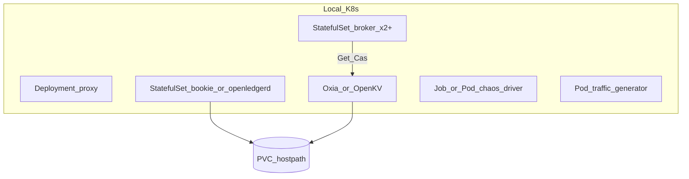

# 本地 K8s 测试部署（hostPath CSI）

用于：**Chaos 故障测试**、**带流量运维演练**、**客户验收**。  

一键部署与验收：

```bash
./scripts/k8s-up.sh
./scripts/k8s-customer-accept.sh
./scripts/k8s-fault-drill.sh   # 持续流量 + 杀 broker/bookie
```

**Metadata 默认 Oxia**（复用 `open-ledger` 命名空间已有 `oxia` Service）：

| 环境变量 | 默认 |
|---|---|
| `METADATA_BACKEND` | `oxia` |
| `OXIA_ADDR` | `oxia-0.oxia.open-ledger.svc.cluster.local:6648` |
| `OXIA_PREFIX` | `/om/`（与 OL `/open-ledger/...` 隔离） |

可选：
- `METADATA_BACKEND=openkv` + `OPENKV_GATEWAY=gateway.openkv.svc.cluster.local:19000`（复用本地 `openkv` 命名空间）
- `METADATA_BACKEND=metakv` + `METADATA_URL`；单测 `memory`

**open-ledger（默认已接）**：

| 环境变量 | 默认 |
|---|---|
| `BOOKIE_ADDRS` | `bookie-0..7.bookie.open-ledger.svc.cluster.local:3181` |
| `OL_META_URL` | `http://metakv.open-message.svc.cluster.local:7700`（共享 LedgerMeta） |
| `OL_E` / `OL_QW` / `OL_QA` | `3` / `2` / `2` |

未设 `BOOKIE_ADDRS` 时回退进程内 memory quorum。

约束（已定）：

- 部署目标：**本地 Kubernetes**（kind / minikube / k3d / Docker Desktop K8s，任选其一，文档默认 **kind**）
- 持久化：**CSI 使用 hostPath**（开发测试；非云盘）
- 不在本环境默认使用云厂商 CSI / local-path 以外的复杂存储（若用 local-path provisioner，底层仍映射 hostPath）

---

## 1. 集群拓扑（测试）



| 组件 | 工作负载建议 | 存储 |
|---|---|---|
| Proxy | Deployment，可 2 副本 | 无状态 |
| Broker | StatefulSet，≥2 | 可选空Dir（无消息盘） |
| Bookie / openledgerd | StatefulSet，≥2（M1 可 1） | **PVC → hostPath**（Journal + ledger；见 open-ledger） |
| **Metadata（二选一）** | **Oxia（默认）** 或 **OpenKV** Gateway+Meta+Storage | **PVC → hostPath**（见 design/02 §9） |
| Chaos / Traffic | Job/Deployment | 无 |

Broker **不**再跑自研 Meta Pod。  
- 默认：`METADATA_BACKEND=oxia` + Oxia 地址  
- 可选：`METADATA_BACKEND=openkv` + OpenKV Gateway 地址（如 `:19000`）

---

## 2. hostPath / CSI 约定

### 2.1 推荐方式 A：手工 PV + PVC（绑定明确）

每个需要盘的 Pod 对应：

```text
PersistentVolume
  spec:
    storageClassName: manual-hostpath   # 或 ""
    capacity: 10Gi
    accessModes: [ReadWriteOnce]
    persistentVolumeReclaimPolicy: Retain
    hostPath:
      path: /var/open-message/<cluster>/<component>-<ordinal>
      type: DirectoryOrCreate
PersistentVolumeClaim
  volumeName: <对应 PV>
  storageClassName: manual-hostpath
```

节点约束：StatefulSet 用 `nodeAffinity` / `nodeName` 保证 **PVC 与 Pod 同节点**（单节点 kind 天然满足；多节点 kind 必须钉节点）。

### 2.2 方式 B：hostPath CSI driver / local-path-provisioner

- 安装 [hostpath CSI](https://github.com/kubernetes-csi/csi-driver-host-path) 或 Rancher **local-path-provisioner**（底层 hostPath）。  
- StorageClass 例如：

```yaml
apiVersion: storage.k8s.io/v1
kind: StorageClass
metadata:
  name: om-hostpath
provisioner: docker.io/hostpath          # 或 rancher.io/local-path
volumeBindingMode: WaitForFirstConsumer
reclaimPolicy: Delete
```

**已定**：清单与脚本默认 **StorageClass 名 = `om-hostpath`**；provisioner 实现为 hostPath CSI 或等价 local-path。禁止测试清单依赖 GCE/EBS/NFS。

### 2.3 目录规划（host 上）

```text
/var/open-message/
  bookie-0/journal
  bookie-0/ledgers
  bookie-1/journal
  bookie-1/ledgers
  oxia-0/data          # 默认 Meta：Oxia
  openkv/              # 可选 Meta：OpenKV storage/meta 数据目录
```

Bookie / openledgerd 挂载：

- `/data/journal` ← PVC  
- `/data/ledgers` ← PVC  

Oxia / OpenKV 各自按官方或项目清单挂数据目录。**Journal 与 ledgers 分目录**（可同盘）。

---

## 3. 清单目录（实现时落地）

```text
deploy/k8s/
  kind-config.yaml          # 可选多节点 kind
  namespace.yaml
  storageclass-om-hostpath.yaml
  oxia/                  # 默认 Meta 后端
  openkv/                # 可选 Meta：OpenKV 清单 / 指向已有集群
  bookie/statefulset.yaml   # 或对接 open-ledger openledgerd
  broker/statefulset.yaml   # METADATA_BACKEND=oxia|openkv + 对应 ADDR
  proxy/deployment.yaml
  traffic/generator.yaml
  chaos/rbac.yaml           # 允许删 Pod / 断网络的权限（慎用）
  chaos/driver.yaml
  kustomization.yaml
```

---

## 4. 与测试的衔接

| 测试 | 如何跑 |
|---|---|
| 单测 | 仍本机 `go test`，不上 K8s |
| Chaos C* | 驱动跑在集群内或集群外 kubeconfig；故障动作用 API 删 Pod / 注入 |
| Ops Drill O* | kubectl 滚动、扩缩 StatefulSet、观察流量 Pod 指标 |

故障注入示例（概念）：

```text
kubectl delete pod bookie-0 -n open-message   # C6
kubectl delete pod broker-0 -n open-message   # C1
kubectl rollout restart sts/broker -n open-message  # 需配合 Drain 钩子 O1
```

优雅重启：先调 Admin/Unload API 或 preStop hook 调 Drain，再删 Pod。

---

## 5. kind 快速假设（文档默认）

```bash
kind create cluster --name open-message --config deploy/k8s/kind-config.yaml
kubectl apply -k deploy/k8s/
# 安装 om-hostpath（hostpath CSI 或 local-path）后再 apply StatefulSet
```

单节点 kind 足够 M1；M2 quorum / 杀 Bookie 建议 **≥2 worker** 或至少 **多 Bookie 副本同节点不同 PVC**（同节点杀 Pod 仍可测进程故障；杀节点级需多节点）。

---

## 6. 验收

- Bookie/Meta 数据在宿主机 `/var/open-message/...` 可见，删 Pod 后数据仍在（Retain/PVC 重建可挂回）。  
- Chaos/演练 **不**依赖云 CSI。  
- 测试环境约定：本地 K8s + om-hostpath（与本文一致）。  
