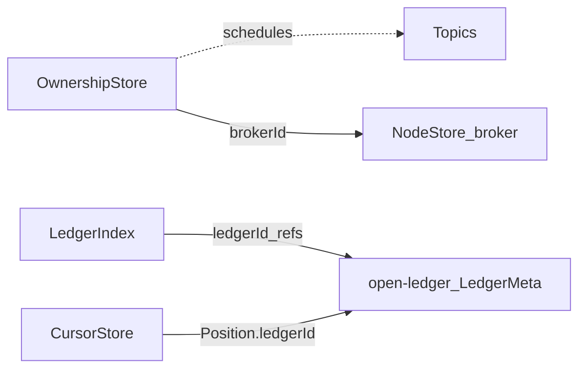
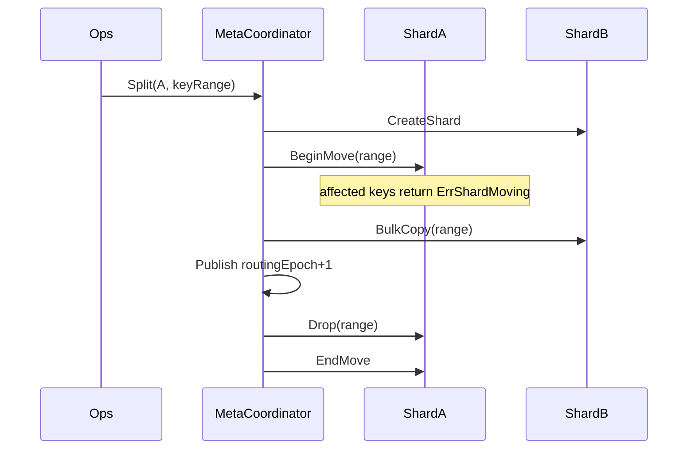

# Metadata 细章（分片 · CAS · 租约 · 高并发）

主文档：§5、§13。通则：[00-principles.md](./00-principles.md)。  
**范围（已定）**：本章只描述 **open-message 业务元数据**。单本 **LedgerMeta / Bookie 注册 / AutoRecovery** 由 [open-ledger](../../../open-ledger/) 自管，见 [19-open-ledger-integration.md](./19-open-ledger-integration.md)。

## 1. 为何合理

- 权威状态外置 → Broker 无状态可迁。  
- **按 key 分片** → 扩容提升**异 key 并发**。  
- **LedgerIndex 只存 ledgerId 链**（小 value）；账本详情在 open-ledger，避免与存储 Meta 双写。  
- Lookup/cursor 与消息 QPS 解耦 → 业务 Meta 不先被打爆。

## 2. 子系统与分片

每条记录外加公共信封字段 **`version`（Cas 单调 +1）**；下表 Value 为业务载荷。完整类型见 §2.1。

| Store | Key | Value 要点 | 分片 |
|---|---|---|---|
| **OwnershipStore** | `own/{ns}/{bundleId}` | `brokerId`；`brokerAddr`；`epoch`；`leaseExpireAt`；`isolationGroup?` | hash(bundleId) |
| **LedgerIndex** | `idx/{tenant}/{ns}/{topic}` | `ledgerIds[]`；`openLedgerId?`；`openStateHint?`（非权威，权威 state 在 open-ledger）；`truncatedBefore?`；**`version`≡chainVersion** | hash(topic) |
| **CursorStore** | `cur/{tenant}/{ns}/{topic}/{sub}` | `markDelete`：`{ledgerId, entryId}`；`individualAcks` | hash(**topic**) |
| **NodeStore** | `node/broker/{id}` | Broker：`addr`；`status`；`lastHeartbeatAt`；`isolationGroups[]`；`labels?`（**不含 Bookie**；Bookie 注册在 open-ledger） | **单分片 / 固定小集** |
| **SchemaStore** | `sch/{tenant}/{ns}/{topic}` | `versions[]`；`compatibility` | hash(topic) |
| **RoutingTable** | `meta/routing` | `epoch`；`numShards`；`shards[]` | 协调分片 / 固定配置片 |

**不在本仓**：`led/{ledgerId}` LedgerMeta、bookie registry、underreplicated 队列 → **open-ledger Metadata**。

路由：`shardId = hash(partitionKey) mod N` 或 consistent hash；节点缓存 `routingEpoch`，遇 `ErrWrongShard` 拉新表。

## 2.1 数据结构（权威定义）

Metadata 整体是 **分片 KV**：每条记录 `(key, value, version)`，通过 `Cas(key, expectVersion, newValue)` 更新。下面是各 Store 的 **key / value** 形态（逻辑模型；编码可为 Protobuf/JSON，实现另定）。

### 通用信封

```text
Record<T> {
  key:     string          // 见各 Store；也是 partition key（或由其导出）
  value:   T
  version: uint64          // 每次成功 Cas +1；期望版本不匹配则冲突
}
```

### OwnershipStore

```text
Key:   "own/{namespace}/{bundleId}"
       // bundleId 建议编码为 hexRange，如 "00000000-7fffffff"

Value: OwnershipRecord {
  brokerId:      string     // Primary 节点唯一 ID
  brokerAddr:    string     // host:port，便于 Lookup 返回
  epoch:         uint64     // fencing token；Acquire/Promote 成功 +1
  leaseExpireAt: int64      // Metadata 服务端时间 UnixMilli
  lastRenewAt:   int64?     // 最近一次成功 Renew（Meta 服务端时间）；供 Standby 早探测
  isolationGroup: string?   // 可选，多租户隔离
  standby: StandbyInfo? {   // M3 Warm Standby；缺省 = 仅冷切主（见 16）
    brokerId:   string
    brokerAddr: string
    syncEpoch:  uint64
    ready:      bool
    assignedAt: int64
  }
}

// 空闲：key 不存在，或显式
Value empty: { brokerId: "", epoch: 0, leaseExpireAt: 0 }
```

API 增量（与 [16](./16-warm-standby.md) 同一 CAS 面）：`AssignStandby` / `ClearStandby` / `PromoteStandby`；冷路径仍 `TryAcquire`（过期或 Unload）。

### LedgerIndex（topic → 账本链，value 保持小）

```text
Key:   "idx/{tenant}/{namespace}/{topic}"
       // 分区 topic 使用物理名，如 "my-topic-partition-3"

Value: LedgerIndexValue {
  ledgerIds:     uint64[]   // 有序；历史 + 当前
  openLedgerId:  uint64?    // 当前可写；无则 null（恢复中/空 topic）
  // 可选摘要，避免每次读 Meta：
  openStateHint: OPEN|IN_RECOVERY|CLOSED|NONE
  truncatedBefore: uint64?  // 已 trim 掉的前缀 ledgerId 下界（可选）
}
// Record.version 即 chainVersion
```

### LedgerMeta（不在本仓）

单本账本详情（E/Qw/Qa、state、fragments、lastEntryId、**OffloadLocation**…）由 **open-ledger** 持久化并 CAS。  
**OffloadLocation 只挂 open-ledger LedgerMeta**，本仓 LedgerIndex **不存**。  
Broker 经 open-ledger Client 创建/关闭/恢复；**禁止**在 open-message Metadata 再写一份。见 [20-broker-openledger-contract.md](./20-broker-openledger-contract.md)。

### CursorStore

```text
Key:   "cur/{tenant}/{namespace}/{topic}/{subscription}"

Value: CursorValue {
  markDelete: Position      // cumulative 前缀位点
  individualAcks: AckSet    // M1 固定为空结构；M3 启用
  // AckSet 逻辑形态（预留）：
  //   perLedger: map<ledgerId, bitmaps_or_ranges>
}

Position {
  ledgerId: uint64
  entryId:  int64           // -1 表示「该 ledger 之前全部确认」类哨兵，可选
}
```

分片键取 **topic**（忽略 subscription 后缀），保证同 topic 多订阅落同片，便于 trim 扫描。

### NodeStore（仅 Broker；小表，单分片）

```text
Key:   "node/broker/{brokerId}"

Value BrokerNode {
  addr: string
  status: ALIVE|DRAINING|DEAD
  lastHeartbeatAt: int64      // Meta 服务端时间
  isolationGroups: string[]
  labels: map<string,string>  // 可选容量标签
}
```

Bookie 注册 / 磁盘水位 / READONLY → **open-ledger** registry（选 ensemble 由 open-ledger Client 完成）。

### SchemaStore（占位）

```text
Key:   "sch/{tenant}/{namespace}/{topic}"

Value: SchemaValue {
  versions: []{ version: int32, type: string, schemaData: bytes, ts: int64 }
  compatibility: BACKWARD|FORWARD|FULL|NONE
}
```

### 路由表（集群级配置，非业务热点）

```text
Key:   "meta/routing"         // 放协调分片或固定配置分片

Value: RoutingTable {
  epoch:     uint64
  numShards: int
  shards:    []{ shardId, peers[]addr, keyRange_or_slots }
}
```

### 逻辑关系（非外键，靠约定）



**不存**：消息 payload、journal、**LedgerMeta / Bookie registry / AR 队列**（open-ledger）、Bookie 本地 entry。

## 3. 单分片并发模型

- 每 shard = 独立复制组（Raft-like）；**同 key 线性化，异 key 并行**。  
- API：`Get` / `Cas(expectVersion)` / `Delete`。  
- 禁止跨 key 事务；跨 key 用有序步骤 + 幂等补偿。

### 3.1 滚本算法（已定：有序三步，禁止跨系统单 CAS）

**为何不用「一次 CasCloseAndAppend」**

| 方案 | 结论 |
|---|---|
| 单 CAS 同时改「关旧本 + 挂新本」 | 只在 **LedgerMeta 与 Index 同一套 KV** 时可能；现已拆成 open-ledger Meta + 本仓 Index，**无法跨系统原子** |
| **有序三步 + 补偿**（对齐 Pulsar ManagedLedger） | **已定**：正确性靠「Index 为逻辑真相、未挂链 ledger 可 GC」 |

**正常路径（优雅滚本）**

```text
前置：本 Broker 仍是 Owner；当前 openLedgerId = L_old；停向 L_old 赋新 entryId（或排空 in-flight）

1. OL.Close(L_old, lastEntryId)     // 或已 Fence 后的 Recover→CLOSED；权威在 open-ledger
2. L_new = OL.Create(E,Qw,Qa,…)     // 新 LedgerMeta 仅在 open-ledger；返回 ledgerId
3. Cas LedgerIndex(topic, ver):
     ledgerIds.append(L_new)
     openLedgerId = L_new
     // 可选：openStateHint 更新
   成功后恢复向 L_new Append
```

**切主滚本**：先 `OL.Fence+Recover(L_old)`（钉尾），再走 2–3；不要假设旧 Writer 还会 Close。

**并发**：同 topic 滚本只允许 Owner 执行；Cas 冲突则重读 Index——若 `openLedgerId` 已是别人挂上的新本，则本轮滚本结束，改用该本写。

**失败补偿**

| 失败点 | 状态 | 自愈 |
|---|---|---|
| 1 失败 | L_old 仍 OPEN/IN_RECOVERY | 重试 Close/Recover；**不** Create，**不**改 Index |
| 2 失败 | L_old 已 CLOSED，无 L_new | 重试 Create；Index 仍指向 L_old（只读）直到 3 成功前不可写——Owner 应尽快完成 2–3 或对客户端返回 Unavailable |
| 2 成功、3 失败 | L_new 存在但未挂链 | **重试 Cas**（若已含 L_new 则成功）；永久失败 → **MarkOrphan(L_new)** + [22](./22-orphan-gc.md)；写路径不可用直至 Index 有新 open |
| 3 成功 | 完成 | — |

**不变量**

1. `LedgerIndex.openLedgerId` 至多一个；为 null 仅允许短暂恢复窗。  
2. Index 中每个 id **必须**能在 open-ledger 查到对应 LedgerMeta（最终）；允许短暂「OL 有、Index 无」（orphan）。  
3. **禁止** Index 指向尚未 Create 成功的 id。  
4. 已 Receipt 的 entry 只依赖 L_old 在 open-ledger 的 CLOSED 尾，与是否已挂 L_new 无关。

## 4. Ownership 租约

```text
TryAcquire(bundle, brokerId, leaseTTL):
  if missing OR now>leaseExpire OR (same broker renew):
    CAS epoch' = epoch+1 (or 1), leaseExpire=now+TTL
  else deny

Renew(bundle, brokerId, epoch, leaseTTL):
  CAS only if brokerId+epoch match

Unload(bundle, brokerId, epoch):
  CAS clear if match
```

- 心跳续约周期 ≪ TTL（如 renew=3s, TTL=15s）。  
- 检测宕机：TTL 过期 → 他者 Acquire（L2 自愈）。  
- 时钟：以 **Metadata 分片服务端时间** 比较 leaseExpire。

## 5. 故障与自愈

| 故障 | 检测 | 隔离 | 收敛 | 续服 |
|---|---|---|---|---|
| 分片 leader 切换 | 客户端超时 | — | 重试 Cas/Get | 自动 |
| 分片迁移动中 | `ErrShardMoving` / `ErrWrongShard` | 写短暂拒 | 更新 routingEpoch 再试 | 自动 |
| Ownership 双主竞态 | CAS | 仅一者成功 | epoch 单调 | 败者停写 |
| Broker 持有过期 epoch | 写时校验 / Meta Renew 失败 | 本地 fence topic | Unload 或自杀该 bundle | 他者 Acquire |
| Meta 脑裂（实现必须防） | raft 选举 | 旧 leader 任期失效 | 单 leader | — |
| Orphan ledger | GC | — | Delete 无索引引用且 CLOSED/超时未挂链 | 后台；细则 [22-orphan-gc.md](./22-orphan-gc.md) |

**雪崩防护**：Client/Broker 对 Meta 使用指数退避 + jitter；`ErrShardMoving` 不立即打满重试。

## 6. 扩容（抬高并发的正确姿势）



| 扩容手段 | 写并发 | 读并发 |
|---|---|---|
| **加分片 + split** | ↑（目标手段） | ↑ |
| 单分片加 follower | 基本不变 | ↑ |
| 只加空闲机器不 split | 不变 | 不变 |

验收：均匀随机 key 的 Cas QPS 随 shard 数近似上升；迁移期间无关 key 的 P99 不明显恶化。

## 7. 热路径降载（否则无法扩到高消息并发）

### 7.0 澄清：不是每条消息都写 Metadata

**结论：否。** Produce / Consume 的热路径写的是 **LedgerStore（Bookie）**，不是 Metadata。

| 操作 | 每条消息是否写 Metadata？ | 实际写哪里 |
|---|---|---|
| **Produce（Push/Send）** | **否** | 只 `Append` 到当前 OPEN ledger 的 Bookie（Qa 确认）；MessageID 在内存分配 |
| **Consume（推送/拉取读）** | **否** | 从 EntryCache 或 Bookie `Read` |
| **Ack** | **默认否（逐条）** | 先更新 Broker 内存 cursor；**合并后周期性** `CasAdvance` CursorStore |
| Lookup / 建连 | 偶尔读 Ownership（可缓存） | 不写，或仅续约心跳 |

**Produce 才会写 Metadata 的时机（远低于消息 QPS）**：

- 滚本：open-ledger Close/Create + 本仓 Cas LedgerIndex  
- 写失败换 fragment：由 **open-ledger Client** 更新其 LedgerMeta（Broker 不写）  

- Owner 变更 / Recover：Fence 相关 Meta 状态  

**Consume/Ack 写 Metadata 的时机**：

- Cursor 合并刷盘（按时间/条数，如每 50ms 或每 N 条 ack）  
- 订阅创建、Unload 前强制 flush  

若做成「每 Produce/每 Ack 都同步 Cas Metadata」，Meta 会先于 Bookie 成为瓶颈，**违反 §7 目标与扩容模型**——视为设计缺陷。

### 7.0.1 「消费到哪里了」记在哪

用户问的消费进度 ≠ 消息正文。

| 记什么 | 记在哪 | 形态 |
|---|---|---|
| **消费进度（权威）** | Metadata **CursorStore** | `markDelete = (ledgerId, entryId)`，按 `(topic, subscription)` 一条记录 |
| **消费进度（热）** | Owner Broker **内存** | 先推进，再合并刷到 CursorStore |
| **消息正文** | **Bookie / Ledger** | 不因 ack 被「搬家」；位点越过且 retention 允许后整本 ledger 删除 |

```text
CursorStore key:  cur/{tenant}/{ns}/{topic}/{subscription}
value:            { markDelete: { ledgerId, entryId }, version, ... }

含义: 该订阅已确认消费完 markDelete 及之前；下次从下一条开始推。
```

- 换 Broker / 进程重启：新 owner **读 CursorStore** 恢复进度（可能重复一小段未刷盘 ack → at-least-once）。  
- 同一 topic 多个 subscription = 多条 cursor，互不影响。  
- M1 只做 cumulative；individual 空洞预留在同一条 Cursor 记录里（见 §2.1）。

### 7.1 降载手段

1. Broker **Owner 缓存**（TTL ≤ lease 剩余）。  
2. Owner 上 **LedgerIndex 本地镜像**（以 chainVersion 校验）。  
3. Cursor **合并刷盘**（禁止默认每 ack 同步写 Meta）。  
4. 目标：`Meta写QPS << 消息QPS`（通常差几个数量级）。

## 8. 不变量

1. 任意 API 含 partition key；Lookup 禁止全集群扫描。  
2. 同 bundle 至多一个有效 (brokerId, epoch)。  
3. 某 topic 至多一个 openLedgerId 在 Index 中。  
4. LedgerMeta 与 Index 最终一致（允许短暂 orphan，由 GC 收）。  

## 9. 底层存储选型（已定）

Metadata **对外**永远是分片 KV + `Cas(version)`。  
**对内支持两套生产后端（已定）**，同一适配接口切换：

| 后端 | 配置 | 地位 |
|---|---|---|
| **Apache Oxia** | `METADATA_BACKEND=oxia` | **默认**；优先落地 |
| **OpenKV** | `METADATA_BACKEND=openkv` | **一等支持**；同仓生态可选（`/Users/.../amydemo/openkv` 或部署地址） |
| `memory` | `METADATA_BACKEND=memory` | **仅单测** |

不再以自研 Pebble/Raft Meta 为主路径。

### 9.1 统一适配层

```text
Broker / Proxy
    │  Get / Cas(key, expectVer) / Delete
    ▼
Metadata 适配层（本仓 · 同一 Store 接口）
    │
    ├── oxia   → Apache Oxia client（version / compare-and-put）
    └── openkv → OpenKV Gateway gRPC（PutCAS / Get.revision / DeleteCAS）
```

| 我们负责 | 后端负责 |
|---|---|
| key 编码、各 Store 语义、滚本多步补偿 | 分片、持久、副本 HA |
| Ownership 租约（value 内 `leaseExpireAt` + Cas；TTL 仅辅助） | 提供 Cas + Get |
| `METADATA_BACKEND` 切换；禁止混用两后端写同一逻辑集群 | Watch（有则接 Standby） |

两端均须验收：

| 能力 | 用途 |
|---|---|
| 按 key 版本 CAS | Ownership、滚本、cursor |
| 分片扩展后异 key 写并行 | 加节点抬 Meta 并发 |
| 低延迟 Get；Cas 后可读自己的写 | Lookup / Fence |
| 持久 + HA | 权威 Meta |

### 9.2 Oxia（默认）

| 项 | 约定 |
|---|---|
| 为何默认 | 为大规模 meta 设计；与 Pulsar 元数据演进同向 |
| 客户端 | 官方 / 社区 Oxia client |
| 加分 | Watch、session/TTL（抢主权威仍 Cas + epoch） |

### 9.3 OpenKV（一等支持）

| 项 | 约定 |
|---|---|
| 项目 | [OpenKV](../../../amydemo/openkv/)（Range Region + Multi-Raft + RocksDB；Gateway gRPC） |
| 映射 | `Cas` → `PutCAS(expected_revision)`；冲突 → `cas_failed` + `current_revision`；`expected=0` = create-only |
| revision | 只用 **Gateway MVCC 平面**（`Get.revision` / commit_ts）；勿与 plain Propose apply-index 混用 |
| 分片 | Range；Cursor 用 `cur/.../topic/` 前缀共 Region；Ownership 可用 hash 前缀打散 |
| 租约 | 主路径仍 value + Cas；`ttl_ms` 可选辅助过期删 key |
| 为何支持 | 自研可控、与本地生态一体；CAS 已落地（见 OpenKV `docs/flows/13-version-cas.md`） |

### 9.4 本地部署

- 默认 profile：部署 **Oxia**；`METADATA_BACKEND=oxia`。  
- 可选 profile：部署 **OpenKV**（Gateway + Meta + Storage）；`METADATA_BACKEND=openkv` + Gateway 地址。  
- 数据盘跟所选后端节点走（hostPath / PVC）。细则见 [deploy/local-k8s.md](../deploy/local-k8s.md)。

### 9.5 不选作主路径 / 终态

| 引擎 | 地位 |
|---|---|
| 自研 Pebble + 每分片 Raft Meta | **不作为主路径** |
| 进程内 map | **仅单测** |
| ZK / 单 etcd 堆全量业务 meta | 不作终态 |
| MySQL / Redis Cluster 当权威 Meta | 不作终态 |
| open-ledger / Bookie | **消息体**，不是 Meta |

**Bookie Journal ≠ Meta**：消息在 open-ledger；Meta 只存小 KV（Oxia 或 OpenKV）。

## 10. 阶段

- **M0**：Metadata 接口 + `memory`；**Oxia 与 OpenKV 适配骨架**。  
- **M1**：默认 **Oxia**；本仓 Cas：**Ownership / LedgerIndex / Cursor / BrokerNode**（**无** LedgerMeta）；OpenKV 可切换同用例。  
- **M2+**：两后端分片扩容；Watch 接 Standby（见 F3.7）；与 Warm Standby 同里程碑。