# 端到端流程：设计图与时序图（总册）

**地位**：架构侧**流程与设计图权威总册**。细章可有局部图；与本册冲突时，以本册 + 该细章文字不变量为准，并开传播修正。  
四目标：[34](./34-architecture-goals.md)。  
**权责**：[19](./19-open-ledger-integration.md)、[20](./20-broker-openledger-contract.md)。

覆盖：Client/Proxy 生产消费 → Lookup/背压/幂等 → Owner 生命周期 → Fence/Recover/滚本 → 四订阅分发 → 热备 Promote → 三面扩缩 → Orphan/Offload/双 Meta → 用户无感路径。

---

## 目录（流程清单）

| ID | 流程 | 本节 | 关联细章 |
|---|---|---|---|
| G0 | 集群总览架构 | §0 | architecture |
| P1 | Produce（Lookup→Receipt） | §1 | 08、10、21 |
| P2 | Produce 背压 / NotOwner / 换 fragment | §1.3–1.5 | 08、10 |
| C1 | Consume + Ack（Exclusive） | §2 | 04、08 |
| C2 | Failover 后续消费 | §2.4 | 04、15 |
| F1 | Owner 崩溃冷切 | §3.1–3.2 | 06、09、15 |
| F2 | 优雅 Unload / Drain | §3.3 | 09、15、32 |
| R1 | Fence + Recover | §4 | 11、20 |
| L1 | 正常滚本三步 | §5 | 02 §3.1 |
| S1–S3 | 扩容 Broker / Bookie / Meta | §6–§8 | 05、02、architecture §6 |
| AR | AutoRecovery 补副本 | §9 | 03 |
| PX | **经 Proxy 生产/消费** | §10 | 14 |
| ID | **生产幂等 M2/M3** | §11 | 23 |
| DS | **Shared / Key_Shared 分发** | §12 | 18 |
| WS | **Warm Standby Promote** | §13 | 16、26 |
| OR | **滚本失败 → MarkOrphan** | §14 | 02、22 |
| OF | **Offload 冷层** | §15 | 24 |
| DM | **双 Meta 对账** | §16 | 27 |
| SI | **缩容 Broker** | §17 | 05、32 |
| UX | **用户无感路径（Client 视角）** | §18 | 15、33、34 |
| IX | **全库设计图索引** | §19 | — |
| CR | **组件角色职能**（非时序，角色合同） | [35](./35-component-roles.md) | architecture §7 |

**规则**：新增大流程必须在本表挂号 + 本节或细章有图；仅聊天描述不算设计完成。新增组件角色必须先写入 [35](./35-component-roles.md)。  
**合理性**：每一 ID 须有合理性说明（守护不变量 / 为何此序 / 放弃方案）——权威摘要见 [37 §8](./37-design-rationale.md)；细章可加深。无合理性不得冻结该流程。

---

## 0. 总览架构图

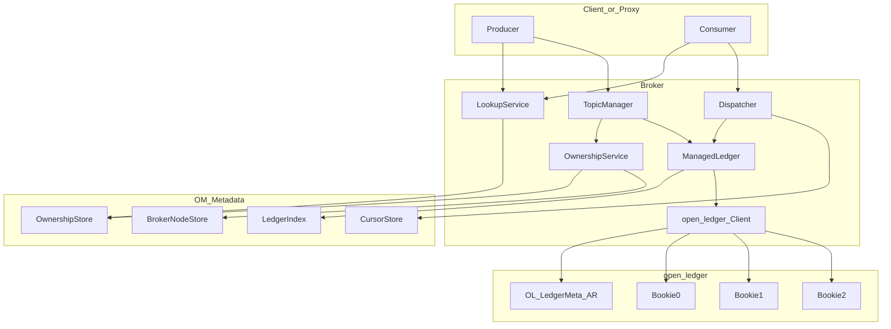

---

## 1. 客户端：发送消息（Produce）

### 1.1 组件协作（设计图）

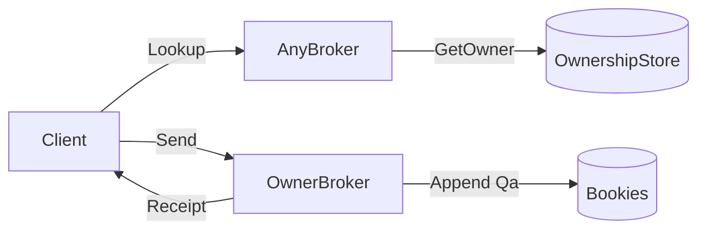

### 1.2 时序：首次生产（含 Lookup）

```mermaid
sequenceDiagram
  autonumber
  participant C as Client
  participant Any as AnyBroker
  participant Meta as Metadata
  participant Own as OwnerBroker
  participant OL as open_ledger_Client
  participant BK as BookieQuorum

  C->>Any: Lookup(topic)
  Any->>Meta: GetOwner(bundle(topic))
  alt no_owner
    Any->>Meta: TryAcquire(bundle, self)
    Meta-->>Any: epoch=e
    Note over Any: Any becomes Owner
    Any-->>C: LookupResponse(addr=Any, epoch=e)
  else has_owner
    Meta-->>Any: broker=Own, epoch=e
    Any-->>C: LookupResponse(addr=Own, epoch=e)
  end

  C->>Own: Connect + Producer(topic)
  Own->>Own: assert local epoch & Ready
  Own-->>C: ProducerSuccess

  C->>Own: Send(payload)  inflight < maxPending
  Own->>Own: entryId = next++
  Own->>OL: Append(ledgerId, entryId, lac, payload)
  OL->>BK: parallel AddEntry
  BK-->>OL: journal_ack x Qa
  OL-->>Own: OK
  Own->>Own: advance LAC continuously; release Receipt
  Own-->>C: SendReceipt(MessageID=ledgerId:entryId)
```

### 1.3 时序：背压满窗

```mermaid
sequenceDiagram
  participant C as Client
  participant Own as OwnerBroker

  loop until window full
    C->>Own: Send
    Own-->>C: SendReceipt
  end
  Note over C: inflight == maxPending
  C->>C: block or ErrBackpressure
  Own-->>C: SendReceipt (oldest)
  Note over C: inflight--; may Send again
```

### 1.4 时序：NotOwner / 切主后重发

```mermaid
sequenceDiagram
  autonumber
  participant C as Client
  participant Old as OldOwner
  participant Meta as Metadata
  participant New as NewOwner

  C->>Old: Send
  Old-->>C: SendError(NotOwner) or timeout
  C->>Meta: Lookup via AnyBroker
  Meta-->>C: NewOwner addr, epoch=e2
  C->>New: Connect + Producer
  C->>New: Send(same payload)  Note: M1 at-least-once; M2 idempotent seq
  New-->>C: SendReceipt(MessageID)
```

### 1.5 时序：写路径 Bookie 未达 Qa → 换 fragment

```mermaid
sequenceDiagram
  autonumber
  participant W as OwnerWriter
  participant OL as open_ledger_Client
  participant BK as Bookies

  W->>OL: Append
  OL->>BK: AddEntry to Qw
  BK-->>OL: only Qa-1 acks / timeout
  OL-->>W: not yet durable
  W->>W: do NOT Receipt
  Note over OL: CAS OL LedgerMeta new fragment
  OL->>BK: rewrite unacked to new quorum
  BK-->>OL: Qa acks
  OL-->>W: Append OK lac
  W->>W: advance LAC; Client Receipt
```

---

## 2. 客户端：消费消息（Consume + Ack）

### 2.1 组件协作

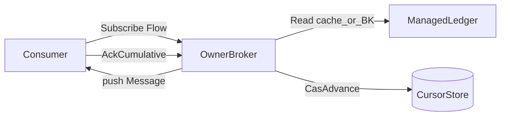

更多分发模式（Shared / Key_Shared / Failover）见 [18-dispatch-modes.md](./18-dispatch-modes.md)。

### 2.2 时序：订阅、推送、累计确认

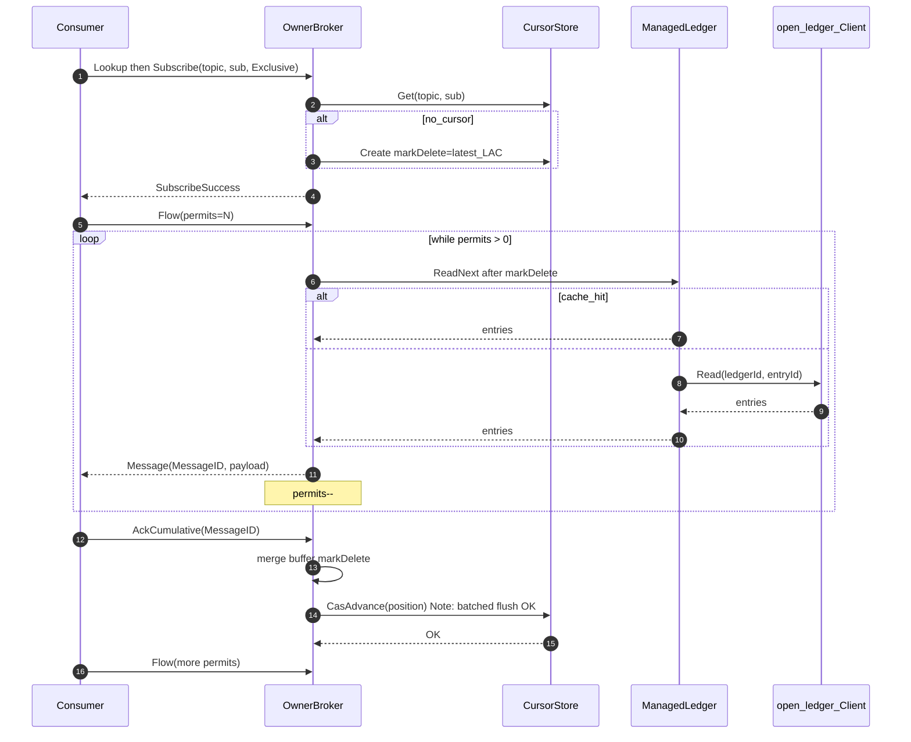

### 2.3 时序：无 permits 背压

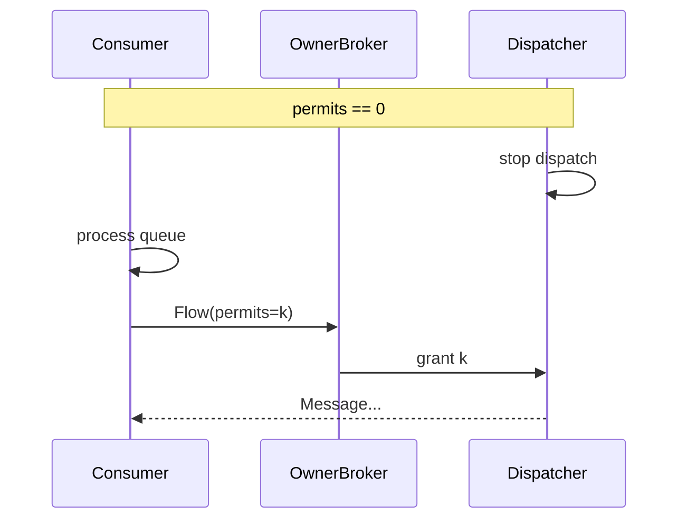

### 2.4 时序：Failover 后消费续跑

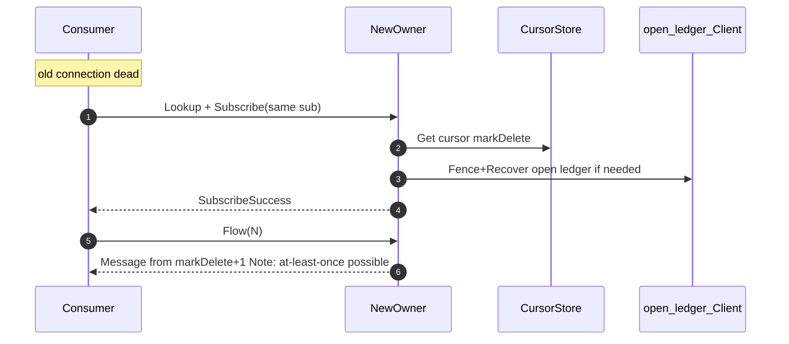

---

## 3. 服务端：Owner 崩溃恢复（Failover）

### 3.1 状态机（设计图）

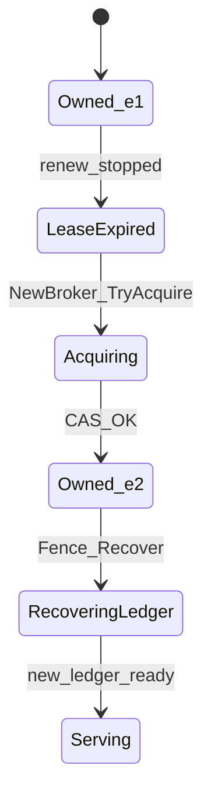

### 3.2 时序：完整 failover

```mermaid
sequenceDiagram
  autonumber
  participant Old as OldOwner
  participant Meta as OM_Metadata
  participant New as NewOwner
  participant OL as open_ledger_Client
  participant C as Client

  Note over Old: crash; lease renew stops
  New->>Meta: TryAcquire(bundle)
  Meta-->>New: epoch=e2
  New->>Meta: GetChain LedgerIndex
  New->>OL: Fence then Recover(L)
  Note over OL: OL LedgerMeta CLOSED
  Note over Old,OL: zombie Append -> ErrFenced
  New->>OL: Create(L2)
  New->>Meta: Cas LedgerIndex append L2
  New->>Meta: Get cursors
  Note over New: Ready

  C->>Old: Send / timeout
  C->>New: Lookup + Send/Subscribe
  New-->>C: Receipt / Messages
```

### 3.3 时序：优雅 Unload（扩容迁主）

```mermaid
sequenceDiagram
  autonumber
  participant Old as OldOwner
  participant Meta as OM_Metadata
  participant New as NewOwner
  participant OL as open_ledger_Client

  Note over Old: Drain
  Old->>Old: reject new Producer; wait inflight
  Old->>OL: Close(L, lac)
  Note over OL: OL LedgerMeta CLOSED
  Old->>Meta: flush cursors
  Old->>Meta: Unload(bundle, epoch=e1)
  New->>Meta: TryAcquire epoch=e2
  New->>Meta: GetChain
  New->>OL: Create(L_new)
  New->>Meta: CasIndex set open
  Note over New: Serving
```

---

## 4. 服务端：账本 Fence + Recover（细节）

**执行体：open-ledger Client**（OL Meta + Bookie）；Broker 只编排后 Cas Index。

### 4.1 设计图

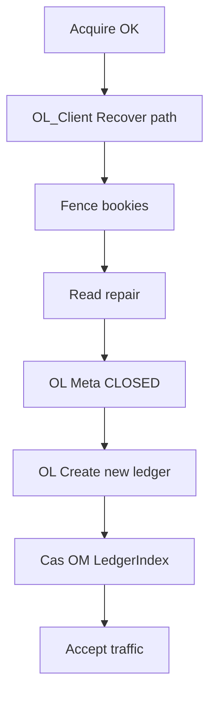

### 4.2 时序

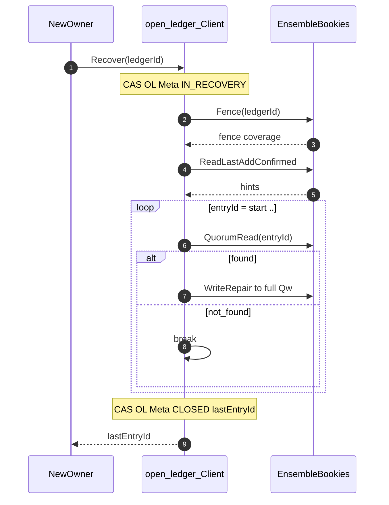

---

## 5. 服务端：滚本（正常写满 / 定时）

**已定**：有序三步；LedgerMeta 只在 open-ledger。见 [02 §3.1](./02-metadata.md)。

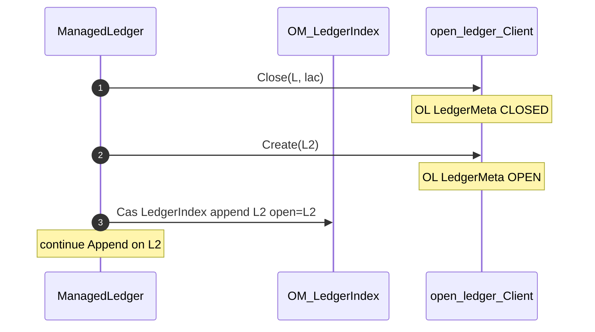

失败补偿见 [02-metadata.md](./02-metadata.md) / [12-cross-failure-scenarios.md](./12-cross-failure-scenarios.md)。

---

## 6. 扩容：加 Broker

### 6.1 设计图

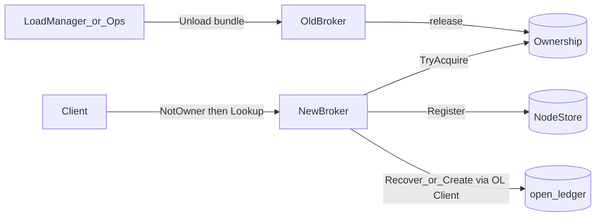

### 6.2 时序

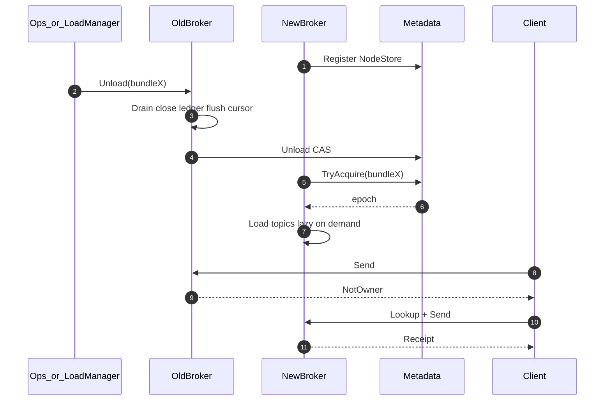

**不搬**：Bookie 上历史 ledger 字节零拷贝。

---

## 7. 扩容：加 Bookie（主存）

### 7.1 设计图

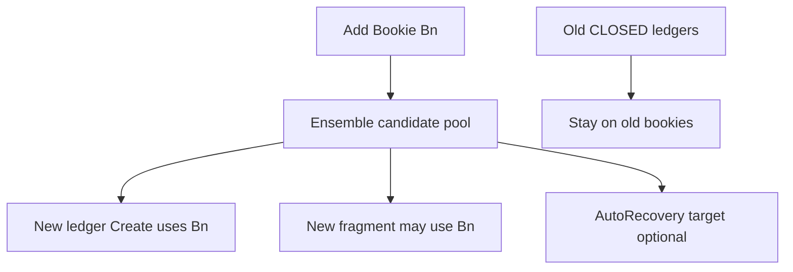

### 7.2 时序：新写入落到新 Bookie

```mermaid
sequenceDiagram
  autonumber
  participant Ops
  participant OLReg as OL_BookieRegistry
  participant ML as ManagedLedger
  participant OL as open_ledger_Client
  participant Bn as NewBookie_openledgerd

  Ops->>OLReg: register bookie Bn
  Note over ML: later roll
  ML->>OL: Create(E,Qw,Qa) 
  Note over OL: Client picks ensemble including Bn; writes OL LedgerMeta
  OL->>Bn: createLedger / addEntry...
  ML->>ML: Cas OM LedgerIndex
```

---

## 8. 扩容：Metadata 加分片（抬异 key 并发）

### 8.1 设计图

```mermaid
flowchart LR
  A[ShardA] -->|split key range| B[ShardB]
  RT[RoutingTable epoch++] --> Brokers
  Brokers -->|hash key| A
  Brokers -->|hash key| B
```

### 8.2 时序

```mermaid
sequenceDiagram
  autonumber
  participant Coord as MetaCoordinator
  participant A as ShardA
  participant B as ShardB
  participant Br as Broker

  Coord->>B: CreateEmptyShard
  Coord->>A: BeginMove(range)
  Br->>A: Cas(key in range)
  A-->>Br: ErrShardMoving
  Br->>Br: backoff retry
  Coord->>B: Copy keys
  Coord->>Coord: routingEpoch++
  Coord->>A: Drop range / EndMove
  Br->>B: Cas(key) success
```

---

## 9. AutoRecovery 补副本（**open-ledger**；非 Broker）

```mermaid
sequenceDiagram
  autonumber
  participant Aud as OL_Auditor
  participant Q as OL_RecoveryQueue
  participant W as OL_ReplWorker
  participant Src as SourceBookie
  participant Dst as NewBookie
  participant Meta as OL_LedgerMeta

  Aud->>Aud: detect underreplicated after delay
  Aud->>Q: enqueue task
  W->>Q: claim task
  W->>Src: Read entries
  Src-->>W: data
  W->>Dst: recoveryAdd
  W->>Meta: CAS update fragment ensemble
```

---

## 10. 经 Proxy 生产 / 消费（PX）

生产默认入口。细节：[14](./14-proxy.md)。

### 10.1 设计图

```mermaid
flowchart LR
  C[Client] --> LB[LB_optional]
  LB --> Px[Proxy]
  Px -->|Lookup_cache| Meta[(OM_Ownership)]
  Px -->|forward_OM_frames| Own[OwnerBroker]
  Own --> OL[open_ledger]
  Own --> BK[(Bookies)]
```

### 10.2 时序：Proxy 转发 Produce

```mermaid
sequenceDiagram
  autonumber
  participant C as Client
  participant Px as Proxy
  participant Meta as OM_Metadata
  participant Own as OwnerBroker
  participant OL as open_ledger

  C->>Px: Connect + Producer(topic) + Send
  Px->>Meta: Lookup owner (or cache hit)
  Meta-->>Px: Own addr, epoch
  Px->>Own: forward frames (same requestId/sequence_id)
  Own->>OL: Append → Qa
  Own-->>Px: SendReceipt
  Px-->>C: SendReceipt
  Note over Px: NotOwner → invalidate cache → re-Lookup → limited retry or return to Client
```

### 10.3 不变量

- Proxy **不**持久消息、不赋序、不改 `sequence_id` / `request_id`。  
- Client 只持有 Proxy URL 即可；Owner 变更对用户表现为短暂重试（§18）。

---

## 11. 生产幂等（ID）

权威语义：[23](./23-producer-idempotency.md)；客户摘要：[../user/delivery-semantics.md](../user/delivery-semantics.md)。

### 11.1 设计图（M2 内存 / M3 Meta）

```mermaid
flowchart TD
  Send[Send_seq] --> Hit{seq_in_window?}
  Hit -->|yes| Rec[Return_cached_MessageID]
  Hit -->|no| App[Append_via_OL]
  App --> Qa[Qa_OK]
  Qa --> Map[map_seq_to_MessageID]
  Map --> Rec2[SendReceipt]
  Map -.->|M3 async Cas| Idem[(OM_idem_table)]
```

### 11.2 时序：同 Owner 超时重发（M2）

```mermaid
sequenceDiagram
  autonumber
  participant C as Client
  participant Own as OwnerBroker

  C->>Own: Send(seq=7)
  Note over C,Own: timeout / no Receipt
  C->>Own: Send(seq=7) again
  Own->>Own: hit idempotency map
  Own-->>C: SendReceipt(same MessageID)
  Note over Own: no second Append
```

### 11.3 时序：跨崩溃切主（M2 可重复 / M3 去重）

```mermaid
sequenceDiagram
  autonumber
  participant C as Client
  participant Old as OldOwner
  participant New as NewOwner
  participant Idem as OM_IdemMeta

  Note over Old: crash; M2 window lost
  C->>New: Send(seq=7) after Lookup
  alt M2
    New->>New: Append again
    New-->>C: possibly new MessageID
  else M3
    New->>Idem: lookup seq=7
    Idem-->>New: hit MessageID
    New-->>C: same MessageID no Append
  end
```

---

## 12. Shared / Key_Shared 分发（DS）

权威：[18](./18-dispatch-modes.md)。此处给端到端评审图。

### 12.1 Shared 时序

```mermaid
sequenceDiagram
  autonumber
  participant D as Dispatcher_Shared
  participant C1 as Consumer1
  participant C2 as Consumer2
  participant CS as CursorStore

  C1->>D: Flow(n)
  C2->>D: Flow(m)
  D-->>C1: Message(10)
  D-->>C2: Message(11)
  C1->>D: AckIndividual(10)
  D->>CS: CasAdvance merge individualAcks
  C2->>D: Nack(11)
  D-->>C1: Redeliver(11)
```

### 12.2 Key_Shared 设计图

```mermaid
flowchart LR
  E[Entry_plus_key] --> H[hash]
  H --> T[key_range_table]
  T --> C1[Consumer1]
  T --> C2[Consumer2]
  T -->|rebalance_block| Hold[Pause_key_until_inflight_clear]
```

---

## 13. Warm Standby Promote（WS）

权威：[16](./16-warm-standby.md)、[26](./26-standby-wire.md)。**Promote ≠ 等满 TTL**。

### 13.1 角色图

```mermaid
flowchart TB
  subgraph bundle [Bundle]
    P[Primary]
    S[Standby]
  end
  Meta[(OwnershipStore)]
  BK[(Bookies)]
  Px[Proxy_or_Client]
  Px -->|Produce| P
  P -->|Append| BK
  P -->|soft_state_stream| S
  Meta --- P
  Meta --- S
```

### 13.2 时序：早探测 Promote

```mermaid
sequenceDiagram
  autonumber
  participant P as Primary
  participant S as Standby
  participant Meta as OwnershipStore
  participant OL as open_ledger
  participant C as Client

  Note over P: crash or probe_failed
  S->>S: early_failure_predicate true
  S->>Meta: PromoteStandby CAS (new epoch)
  Meta-->>S: OK epoch=e2
  S->>OL: Fence + short align / Recover if needed
  Note over S: Ready; old epoch writes fail
  C->>P: timeout / NotOwner
  C->>S: Lookup + Send
  S-->>C: Receipt
```

### 13.3 禁止

- 双 Primary 同时对外成功写。  
- 跳过 Fence 对外 Receipt。  
- Standby 用 `max(本地cursor, Meta)` 覆盖 CursorStore。

---

## 14. 滚本失败 → MarkOrphan（OR）

权威：[02 §3.1](./02-metadata.md)、[22](./22-orphan-gc.md)。

```mermaid
sequenceDiagram
  autonumber
  participant ML as ManagedLedger
  participant OL as open_ledger
  participant Idx as OM_LedgerIndex
  participant GC as OrphanGC

  ML->>OL: Close(L)
  ML->>OL: Create(L2)
  OL-->>ML: L2 OPEN
  ML->>Idx: Cas append L2
  Idx-->>ML: FAIL / lost
  Note over ML: retry Cas
  alt Cas eventually OK
    ML->>ML: write on L2
  else permanent fail
    ML->>OL: MarkOrphan(L2)
    GC->>OL: after grace delete orphan
  end
```

**禁止**：抽样 Index 导出当删除依据；GC 与挂回竞态窗口删活本。

---

## 15. Offload 冷层（OF）

权威：[24](./24-offload.md)。location **仅** OL LedgerMeta。

```mermaid
sequenceDiagram
  autonumber
  participant Adm as Admin_or_Policy
  participant Br as Broker
  participant OL as open_ledger
  participant Obj as ObjectStore
  participant BK as Bookies

  Adm->>Br: offload ledger L (CLOSED)
  Br->>OL: Offload(L)
  OL->>Obj: put segments
  OL->>OL: CAS LedgerMeta OffloadLocation
  Note over OL: verify readable from Obj
  OL->>BK: delete hot copies per policy
  Br-->>Adm: Done
```

---

## 16. 双 Meta 对账（DM）

权威：[27](./27-dual-meta-ops.md)。

```mermaid
flowchart LR
  Exp[Export_OM_LedgerIndex_refs] --> Diff[Diff]
  OL[Export_OL_LedgerMeta_ids] --> Diff
  Diff -->|in_OM_missing_OL| Alert1[Critical_gap]
  Diff -->|in_OL_not_in_OM| Cand[Orphan_candidate]
  Cand --> Grace[MarkOrphan_after_grace]
```

```mermaid
sequenceDiagram
  autonumber
  participant Job as ReconcileJob
  participant OM as OM_Meta
  participant OL as OL_Meta
  participant Alert as Alerting

  Job->>OM: full ledgerId refs
  Job->>OL: ledgerId set + orphan flags
  Job->>Job: diff
  alt missing_OL
    Job->>Alert: index_ledger_missing_ol
  else orphan_candidate
    Job->>OL: MarkOrphan if policy allows
  end
```

---

## 17. 缩容 Broker（SI）

扩容见 §6；缩容必须先迁走。权威：[32 §5](./32-operations.md)。

```mermaid
sequenceDiagram
  autonumber
  participant Ops
  participant Bold as VictimBroker
  participant Bkeep as RemainingBroker
  participant Meta as Ownership
  participant C as Client

  Ops->>Bold: Drain
  Ops->>Bold: Unload all bundles
  Bold->>Meta: Unload CAS each
  Bkeep->>Meta: TryAcquire
  Note over Bkeep: Recover/Create as needed; Ready
  Ops->>Bold: offline process
  C->>Bold: fail / NotOwner
  C->>Bkeep: Lookup + continue
```

护栏：隔离组 `min_*`；不得缩到单点过密。

---

## 18. 用户无感路径（UX）— Client 视角

对应四目标「故障/运维对用户无感」：[34 §4](./34-architecture-goals.md)、[33](./33-customer-usage.md)。

```mermaid
sequenceDiagram
  autonumber
  participant App as Application
  participant SDK as Client_SDK
  participant Px as Proxy
  participant Own as Owner

  App->>SDK: Send / Receive
  Note over Own: Drain or crash window
  SDK->>Px: Send
  Px-->>SDK: NotOwner / Timeout
  SDK->>SDK: backoff + jitter + Lookup
  SDK->>Px: retry same seq if idempotent
  Px->>Own: forward to new Owner
  Own-->>SDK: Receipt / Message
  SDK-->>App: success callback
  Note over App: no manual cluster repair
```

**无感** = 应用无人工介入；允许 SDK 层短暂错误与重试。

---

## 19. 全库设计图索引（跨文档）

本册未重复绘制、但评审必须覆盖的图：

| 主题 | 文档位置 |
|---|---|
| 集群/组件总览（主文档） | [architecture.md](../architecture.md) §2 |
| Meta 分片与 Cas | [02](./02-metadata.md)、architecture §5 |
| Fencing / Ownership 状态 | [06](./06-fencing-consistency.md)、architecture §17 |
| 写路径 LAC | [10](./10-ledger-write-path.md) |
| Proxy 边界 | [14](./14-proxy.md) |
| 可用性窗口 / Drain | [15](./15-availability-failover-window.md) |
| Warm Standby 全文图 | [16](./16-warm-standby.md) |
| vs BookKeeper | [17](./17-storage-vs-bookkeeper.md) |
| 四模式 Dispatcher | [18](./18-dispatch-modes.md) |
| 本地 K8s 拓扑 | [../deploy/local-k8s.md](../deploy/local-k8s.md) |

---

## 20. 按角色速查

| 角色意图 | 图 |
|---|---|
| 发消息 | §1、§10、§11 |
| 收消息 / 四模式 | §2、§12 |
| 主挂了 / 热备 | §3、§4、§13 |
| 加/缩 Broker、Bookie、Meta | §6–§8、§17 |
| 副本不够 / Offload / Orphan | §9、§14、§15 |
| 双 Meta | §16 |
| 用户为何无感 | §18 |
| 全库其它图 | §19 |

---

## 21. 图例约定

- **实线箭头**：同步 RPC / 命令  
- **虚线**：可选 / 异步 / 非权威路径  
- **Note**：关键不变量或阶段结论  
- **autonumber**：便于评审点名步骤  
- Client 在 NotOwner/超时后必须 **Lookup**，不得在旧连接上盲重试写成功路径  
- 新增流程：先改本节目录表挂号，再补图；**聊天不算权威**  
