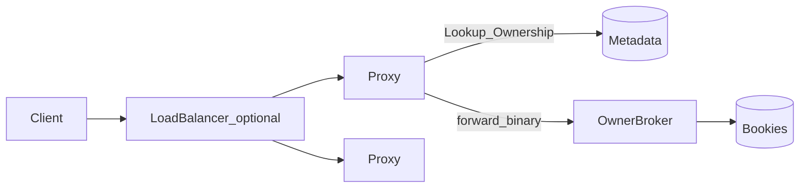
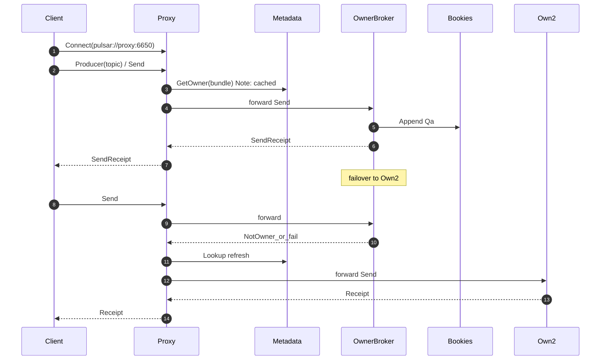

# Proxy 细章

通则：[00-principles.md](./00-principles.md)。关联：[05-routing-bundle.md](./05-routing-bundle.md)、[08-client-backpressure.md](./08-client-backpressure.md)、[13-flows-and-diagrams.md](./13-flows-and-diagrams.md)。

## 1. 为何合理（含「为何需要」）

| 问 | 答 |
|---|---|
| 问题 | 数据面须打到 Owner，但 Client 不能枚举全部 Broker（云/K8s/公网） |
| 选型 | Proxy 统一入口 + Lookup 缓存 + 帧转发；无持久消息 |
| 放弃 | 「无状态就不需要网关」；Proxy 赋序/落盘 |
| 代价 | 多一跳延迟；缓存陈旧靠 NotOwner 纠正 |
| 验收 | 14 验收；Client 只配 Proxy URL 可收发 |

Broker 无消息数据状态，但 **数据面仍必须打到 topic/bundle 的 owner**。因此：

| 模式 | 客户端行为 | 适用 |
|---|---|---|
| **直连 Broker** | Lookup 后自行连 owner；能访问全部 Broker 地址 | 开发、内网平坦网络 |
| **经 Proxy** | 只连 Proxy（或 LB→Proxy）；由 Proxy 查 owner 并转发 | **云 / K8s / 安全隔离 / 公网** —— **生产默认需要** |

结论：**架构上 Proxy 是一等入口组件**；不是「有了无状态 Broker 就不需要网关」。无状态解决的是扩容不搬数据，不解决「客户端不能直连所有 Broker」和「连接地址爆炸」。

## 2. 职责边界

| Proxy **做** | Proxy **不做** |
|---|---|
| 接受 Client 长连接（单一 service URL） | 持久化消息、cursor、ownership 权威 |
| 读 Metadata 做 Lookup / 缓存 owner | 成为第二个排序 writer（禁止本地赋序落盘） |
| 将 Produce/Consume/Ack **转发**到当前 owner | 替代 Bookie |
| TLS 终结、可选认证透传 / 校验 | 跨 bundle 的业务聚合（非首期） |
| Owner 变更时重解析并切后端连接 | 永久本地会话状态（进程可丢，Client 重连即可） |

Proxy **也是无持久消息状态**的；可水平加实例，前面挂 LB。

## 3. 数据面时序（经 Proxy）

对 Client：**始终只看见 Proxy 地址**；切主由 Proxy 消化（或返回可重试错误，由 Client 重试同一 Proxy）。

## 4. 与「直连」双模式

| | 直连 | Proxy |
|---|---|---|
| Client 配置 | 种子 Broker 列表 + 跟随 redirect | 单个（或 LB）URL |
| 网络 | Client ↔ 所有 Broker | Client ↔ Proxy；Proxy ↔ Broker（内网） |
| 多一跳 | 无 | 有（延迟/吞吐代价） |
| 扩 Broker | Client 需能解析新节点地址 | Client 无感；Proxy 拉 NodeStore/Lookup |

**已定**：产品形态以 Proxy 为默认接入；集成测试可直连加快调试。

## 5. 故障与自愈

| 故障 | 自愈 |
|---|---|
| 单 Proxy 挂 | LB 切到其它 Proxy；Client 重连；无消息丢失（未 Receipt 重试） |
| Owner 挂 | Proxy 收到错误 → 刷新 Lookup → 转发新 owner（同直连语义） |
| Proxy 缓存旧 owner | NotOwner → 失效缓存 → 重 Lookup |
| Meta 抖动 | Lookup 退避；已建立的转发连接可继续直至 owner 变更 |

## 6. 扩容

- **加 Proxy**：无状态复制；LB 加后端。  
- **加 Broker**：Proxy 侧 Lookup 自然指向新 owner，Client 不改配置。  
- Proxy CPU/带宽是新瓶颈面 → 与 Broker 独立扩。

## 7. 安全

- 外网只暴露 Proxy（TLS / mTLS）。  
- Broker/Bookie/Meta 监听内网。  
- 认证可在 Proxy 校验后把 principal 传给 Broker（M2+）。

## 8. 不变量

1. Proxy 不得在本地对消息赋序并当作成功（成功仅当 owner 返回 Receipt）。  
2. 同一 Client 逻辑流仍落到单一 owner 排序（经 Proxy 转发不改变 single-writer）。  
3. Proxy 崩溃不丢已确认数据；未确认由 Client 重试。

## 9. 阶段

| 阶段 | 交付 |
|---|---|
| M1 | 直连验证协议语义；Proxy **设计保留** |
| M2 | Proxy 转发 + owner 缓存 + LB 部署文档 |
| M3 | 认证透传、多协议、可观测 |

## 10. 文档关系修正

Proxy **必做**。M1 可用直连 Broker 调试；**M2 落地 Proxy 进程**。生产默认入口以本章为准，不从交付范围删除。  
与 Broker 共用帧格式：[21-wire-protocol.md](./21-wire-protocol.md)。
