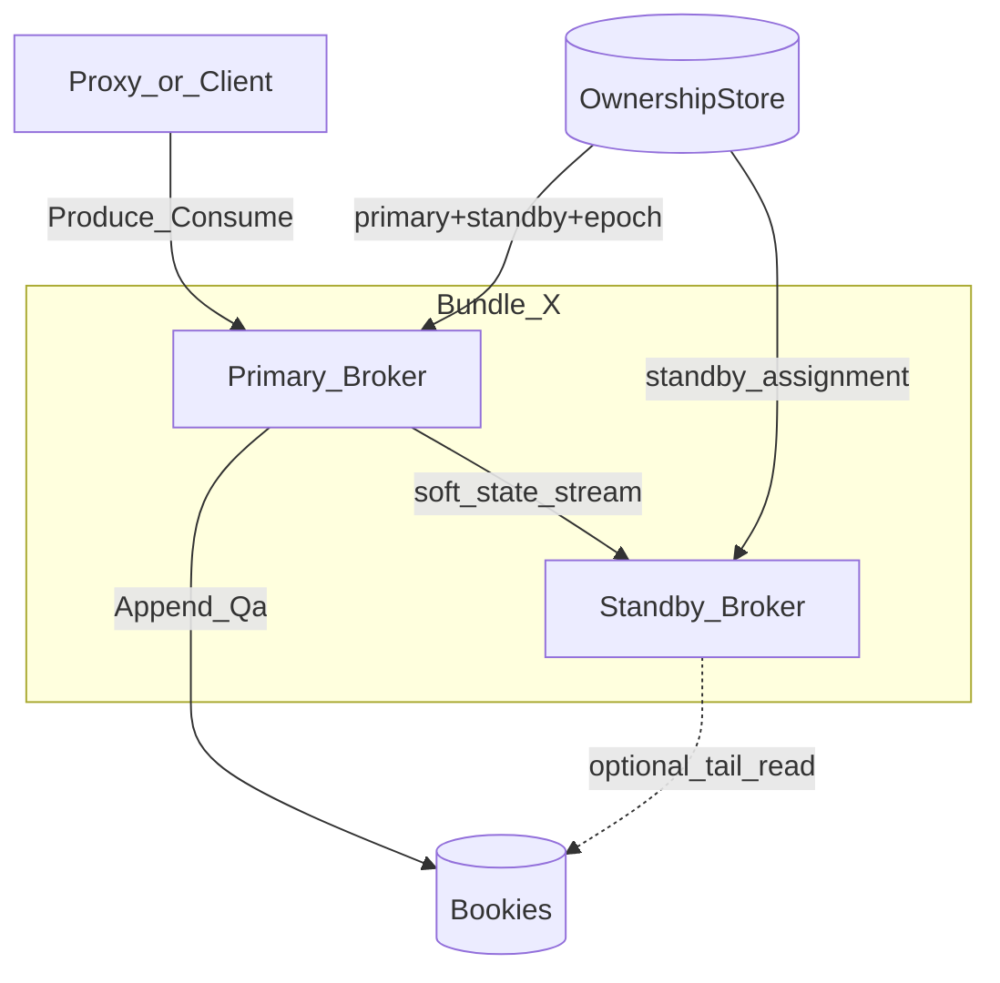
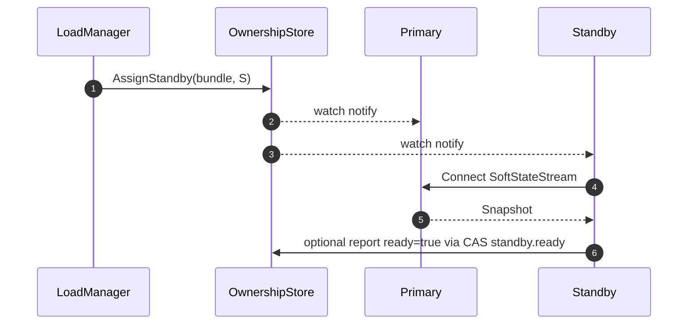

# Warm Standby（热备 Broker）细章

上游问题：[15-availability-failover-window.md](./15-availability-failover-window.md)。  
关联：[06-fencing-consistency.md](./06-fencing-consistency.md)、[09-broker-lifecycle.md](./09-broker-lifecycle.md)、[02-metadata.md](./02-metadata.md)、[01-ledger.md](./01-ledger.md)。

## 0. 优先级（已定）

**本章能力必做**，排在阶段二 / M3：先把 **优雅 Unload、Proxy/SDK 重试、生产幂等、租约/探测、定期滚本**（阶段一）做扎实并达标，再落地热备。

Warm Standby **不是** Pulsar 现成能力，是本架构的进阶交付项；无它时系统仍须完整可用（冷切主），但 **交付清单包含热备，不砍掉**。

## 0. 为何合理

| 问 | 答 |
|---|---|
| 问题 | 冷切主 Acquire+长 Recover 窗口过大 |
| 选型 | 单 Standby 预热软状态；早探测 Promote（≠等满 TTL）+ 仍 Fence |
| 放弃 | 双活成功写；跳过 Fence；等满 TTL 才升主 |
| 代价 | 多占一节点内存/流；探测误判风险（用 Renew 滞后约束） |
| 验收 | 16 不变量；Promote 与 TryAcquire 互斥 |

## 1. 目标

在 **不改变单 writer / 账本 fencing 模型** 的前提下，把 Owner 崩溃后的不可用窗口从：

```text
Acquire + 冷加载 + 长 Recover + 建连
```

压到：

```text
快速探测 + Fence（必做）+ 短路径对齐 + 晋升 Ready
```

**禁止（架构约束，不是砍功能）**：双活同时成功 Produce；省略 Fence；Standby 本地落消息权威盘。

## 2. 角色

| 角色 | 职责 |
|---|---|
| **Owner（Primary）** | 唯一赋序与 Append；对 Client/Proxy 返回 Receipt；续约 ownership lease |
| **Standby（Hot）** | 不对外成功写；预热软状态；可只读预取；随时准备晋升 |
| **Metadata** | 记录 `primary` + `standby`；CAS 晋升；租约仍以 primary 为准 |

同一 bundle：**至多 1 Primary + 1 Standby**（多 Standby 链式若需要另开演进，默认一备）。



## 3. Metadata 数据结构扩展

在 OwnershipRecord 上扩展（兼容：无 standby 字段 = 冷切主）：

```text
OwnershipRecord {
  brokerId, brokerAddr, epoch, leaseExpireAt, version   // 已有 = Primary
  standby: StandbyInfo? {
    brokerId:   string
    brokerAddr: string
    syncEpoch:  uint64    // Standby 已应用的软状态世代；可与 epoch 对齐
    ready:      bool      // 预热是否达到可晋升门槛
    assignedAt: int64
  }
}
```

API 增量（**Ownership 单一 CAS 面**；与冷路径 `TryAcquire` 互斥，同一 key）：

```text
AssignStandby(bundle, standbyBrokerId) -> CAS
ClearStandby(bundle, expectVersion)

// 已定：Promote 本身即 fencing，不必等满 lease TTL
PromoteStandby(bundle, standbyBrokerId, expectPrimaryEpoch) -> newEpoch
  谓词（须同时满足）：
    1. record.standby.brokerId == standbyBrokerId
    2. record.epoch == expectPrimaryEpoch
    3. 故障探测成立（见 §3.1）——**不是**「必须 now > leaseExpireAt」
  成功：epoch' = epoch+1；primary = 原 standby；清除 standby；lease 交给新主
  失败：他者已 Promote / TryAcquire / Primary 仍健康续约 → 本 Standby 退避或冷 Acquire
```

### 3.1 故障探测（已定：可早于满 TTL）

探测目标：压缩 [15](./15-availability-failover-window.md) 的 T0→T3，使热备「快速探测」成立。

| 信号 | 用法 |
|---|---|
| SoftStateStream 连续丢 Heartbeat ≥ N（如 3）且超过 `syncStaleThreshold` | Standby 侧主嫌疑 |
| Primary 对 Meta 的 Renew 滞后（Meta 可见 `lastRenewAt`，或 lease 剩余 ≪ TTL/2 且无续约） | 集群侧确认 |
| 可选：φ accrual / 同事 Broker 探针 | 抑制单通道误判 |

**Promote 允许条件（已定）**：`(stream_stale ∧ renew_lag)` **或** Primary 已 `Unload` **或** `now > leaseExpireAt`（冷兜底）。  
**禁止**：仅一次丢包就 Promote；lease 仍在积极 Renew 时 Promote 成功。

Promote 成功后旧 Primary 下一次 Renew/写 → CAS 失败 / epoch 不匹配 → **立即停写**（与满 TTL 无关）。  
冷路径无 Standby 时仍可用 `TryAcquire`（lease 过期或 Unload 后）；**禁止**与合法 Promote 并行双成功（同一 Ownership CAS）。

## 4. 同步哪些软状态（白名单）

Standby **只复制可丢、可重建的内存态**；权威仍在 Meta/Bookie。

| 类别 | 同步内容 | 方式 | 晋升时用途 |
|---|---|---|---|
| **归属视图** | bundle epoch、topic 列表 | Meta 订阅 + Primary 推送 | 立即知道管哪些 topic |
| **Ledger 视图** | LedgerIndex 镜像、openLedgerId、LAC 提示 | Primary 推送 checkpoint | 少读 Meta |
| **Cursor 热位点** | 各 sub 的 markDelete（内存） | 周期性推送 / 变更流 | 少等 CursorStore；仍以 Meta 为权威校准 |
| **EntryCache 尾部** | 最近 N MB OPEN ledger entries | 推送或 Standby 自己 Read tail | 消费瞬时续上 |
| **连接池** | 到相关 Bookie 的连接 | Standby 自建 | 免冷建连 |
| **不进同步** | Client 连接、未达 Qa 的 in-flight Send、本地赋序器「未确认空洞」 | — | 未 Receipt 仍由 Client 重试 |

### 4.1 软状态通道

```text
Primary → Standby: SoftStateStream (同内网二进制)
  messages:
    Snapshot { bundleEpoch, topics[], ledgerIndex, cursors[], lac, cacheWatermark }
    Delta   { type: CURSOR|LAC|CACHE_ENTRY|TOPIC_LOAD|TOPIC_UNLOAD, ... }
    Heartbeat { primaryEpoch, ts }
```

- 至少每 `syncInterval`（如 100ms–1s）一次 Delta/Heartbeat。  
- Standby `ready=true` 条件：收到过完整 Snapshot，且 `now - lastSync < syncStaleThreshold`，且 `syncEpoch == primary.epoch`。  
- 通道断开 → `ready=false`；退化为冷 Standby（仍可抢主，但窗口变长）。

## 5. Standby **禁止**做什么

1. 对 Client 返回 **成功 SendReceipt**（可拒绝或 307 到 Primary）。  
2. 对 OPEN ledger 做普通 Append（除非已晋升且完成 Fence）。  
3. 把软状态当权威覆盖 CursorStore / LedgerIndex（晋升后必须 **对 OM Meta 校准**；LedgerMeta 仍只在 open-ledger）。  
同步线协议：[26-standby-wire.md](./26-standby-wire.md)。
4. 在 Primary **仍在健康 Renew** 时 `Promote` 成功（防双主）。满 TTL 之前若探测成立且 Renew 已停，Promote **允许**（§3.1）。

## 6. 正常路径

### 6.1 分配 Standby



选主策略：不同机器/机架；同 isolation 组；避免与 Primary 同故障域。

### 6.2 运行中

- Primary：服务 Client + 推送软状态。  
- Standby：更新镜像；可选 `Read` 追 LAC 填 cache；**不接写**。  
- Proxy：Lookup 仍指向 Primary；可缓存 Standby 地址仅用于故障转移优化（非必须）。

## 7. 晋升路径（崩溃切主）

### 7.1 时序

```mermaid
sequenceDiagram
  autonumber
  participant P as Primary
  participant S as Standby
  participant Meta as OM_Metadata
  participant OL as open_ledger_Client
  participant Proxy as Proxy

  Note over P: crash
  S->>S: heartbeat missing / lease path
  S->>Meta: PromoteStandby(expectEpoch)
  alt CAS_OK
    Meta-->>S: new epoch=e2, now primary
    S->>OL: Fence(openLedger)
    Note over S,OL: 不可省略
    S->>OL: ShortRecover using local lac/cache hints
    S->>Meta: calibrate CursorStore / LedgerIndex if needed
    S->>OL: Create new ledger if old closed
    S->>S: Ready as Primary
    Proxy->>S: retry Produce after NotOwner/timeout
  else CAS_fail
    Note over S: another broker won; become idle or new standby
  end
```

### 7.2 短路径 Recover vs 冷 Recover

| | 冷切主 | Warm 晋升 |
|---|---|---|
| Meta GetChain | 要 | 多已有镜像，校验版本即可 |
| Bookie 建连 | 冷 | 已有池 |
| EntryCache | 空 | 常有尾部 |
| Cursor | 全拉 CursorStore | 内存位点 + **一次 Get 校准** |
| Fence | 要 | **要** |
| 读修尾部 | 可能很长 | 从本地 LAC hint 起，通常更短 |

**校准规则（已定，必须）**：

```text
Ready 前：对每个 (topic, sub) 执行 Get(CursorStore)
position := CursorStore.markDelete（及 individualAcks 整值）
禁止：max(本地镜像, Meta)
禁止：用软状态镜像直接对外分发
```

理由：本地镜像可能超前于未刷盘 Meta；若取 max，消费者会从「假 ack」之后续读 → **静默丢消息**，破坏 at-least-once。  
本地镜像 **仅**用于预热 EntryCache / 建连；权威位点 **只认 CursorStore**。结果：可能对已内存 ack 未刷盘区间 **重复投递**（可接受）。

短路径 Recover 的 LAC hint 同理：hint 只缩小扫描起点；**Fence coverage + QuorumRead/repair + CAS CLOSED** 不得省略（算法权威：[open-ledger design §6.4](../../../open-ledger/docs/design.md)）。

### 7.3 优雅切主（仍优先）

计划内：Primary Drain → 可先让 Standby 升主（Unload+Promote）再杀旧进程 → 比崩溃更干净，可跳过长 Recover（正常 Close）。

## 8. 故障与自愈

| 故障 | 处理 |
|---|---|
| Primary 挂、Standby ready | 快速 Promote + Fence + 短 Recover |
| Primary 挂、Standby 未 ready / 无 Standby | 退回冷切主（任何 Broker Acquire） |
| Standby 挂 | ClearStandby；LoadManager 另选；Primary 继续服务 |
| 软状态流中断 | ready=false；Primary 可限速或停推 |
| 旧 Primary 诈尸 | Fence + epoch；Append/续约失败 |
| 双 Standby 误争 | Promote CAS 只成一个 |
| Standby 与 Primary 同机故障 | 调度时反亲和；仍可能冷切 |

## 9. 扩容关系

- 加 Broker：多出来的节点可作各 bundle 的 Standby 池。  
- Standby **不改变**「扩容不搬账本」；只多占计算内存。  
- 缩容：先撤 Standby，再 Unload Primary。

资源账本（设计约束）：

```text
额外内存 ≈ sum(EntryCache尾部 + 句柄 + cursor镜像) per standby bundle
网络 ≈ SoftStateStream 带宽（通常 << 消息吞吐）
```

可用策略：**仅对热点 bundle 开 Standby**，冷 bundle 冷切主，控成本。

## 10. Proxy / Client 配合

| 组件 | 行为 |
|---|---|
| Proxy | 失败重试 Lookup；可选优先连原 Standby（若已 Promote） |
| SDK | 可重试错误 + 幂等；不把窗口当致命 |
| Lookup | Promote 成功后 GetOwner 即新 Primary |

不必让 Client 知道 Standby 概念。

## 11. 不变量

1. 任意时刻至多一个 Primary 能成功 Append/Receipt。  
2. Standby 在晋升完成 Fence 前不能对外成功写。  
3. 晋升后 cursor/ledger 权威以 Metadata/Bookie 校准结果为准。  
4. 无 Standby 时系统功能完整（退化为今日冷切主）。  

## 12. 阶段

| 阶段 | 交付 |
|---|---|
| M1–M2 | 阶段一可用性能力；Ownership 预留 `standby` 字段 |
| M3 | SoftStateStream + Assign/Promote + ready + 反亲和（**必做**） |
| M3+ | 热点 bundle 自动配 Standby；对比冷/热 `failover_duration` |

## 13. 验收

1. Primary kill -9：有 ready Standby 时，`failover_duration` 显著小于冷切主基线。  
2. 晋升过程中旧 Primary 诈尸无法 Receipt。  
3. Standby 挂掉不影响 Primary 正确性。  
4. 关闭 Standby 功能后行为与无热备架构一致。  
5. 消费不丢确认前缀（CursorStore 校准）；允许 at-least-once 重复。  

## 14. 结论

Warm Standby 是 **在单 writer 约束下压缩崩溃窗口的正道**：用内存预热换 RTO，**不换数据面模型**。  
它与 Proxy 重试、优雅发布、生产幂等一起，才构成完整可用性方案；单独做热备却不做重试/优雅发布，收益有限。
