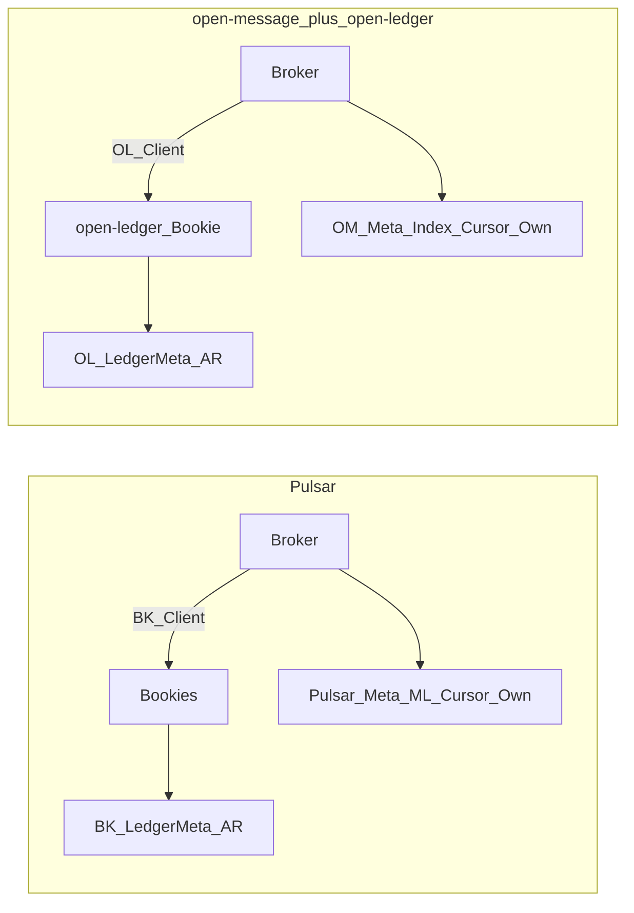

# 主存储：open-message ↔ open-ledger vs Pulsar/BookKeeper

一句话：**语义对齐 BookKeeper；实现为独立仓 open-ledger。账本元数据由 open-ledger 自管，Broker 不参与。**

**实现仓库**：[open-ledger](../../../open-ledger/)（Rust）。  
**权责钉死**：[19-open-ledger-integration.md](./19-open-ledger-integration.md)。

## 0. 为何合理

| 问 | 答 |
|---|---|
| 问题 | 需 BK 语义但要独立实现与权责清晰 |
| 选型 | 语义同构 Pulsar/BK；工程双仓；OL 自管 Meta/AR |
| 放弃 | 绑定官方 BK 协议；Broker 双写 LedgerMeta |
| 代价 | 两仓版本兼容矩阵 |
| 验收 | 对照表读者能分清同/异 |

## 1. 相同点（刻意对齐）

| 概念 | 两边都有 |
|---|---|
| 耐久单元 | Append-only **Ledger** |
| 复制参数 | E / Qw / Qa |
| 写入模型 | 单 Writer；并行 Qw，等 Qa；LAC |
| 关闭语义 | Close/Seal；故障 **Fence + Recover** |
| 计算不落消息盘 | 数据在 Bookie |
| Topic 日志 | ManagedLedger = ledger **id 链** |
| 账本元数据 | **存储侧自管**（BK Meta / open-ledger Meta） |
| 补副本 | **存储侧 AutoRecovery** |

## 2. 元数据分工（已定 · 对齐 Pulsar）

| 层级 | Pulsar | 本项目 |
|---|---|---|
| 单本 LedgerMeta、bookie 注册、AR | **BookKeeper Metadata** | **open-ledger Metadata**（Broker **不写**） |
| Ownership、ML 链、Cursor、策略 | **Pulsar Metadata** | **open-message Metadata**（Oxia/OpenKV） |
| 写入口 | Broker 内 BK Client | Broker 内 **open-ledger Client** |



## 3. 不同点（产品）

| 维度 | Pulsar + BookKeeper | 本项目 |
|---|---|---|
| 产品形态 | BK 独立项目 | **open-ledger** 独立仓 |
| 协议 | 标准 BK | **不**要求兼容 BK 协议；自研 gRPC/API |
| 语言 | Java 为主 | 主存 **Rust**；控制面 open-message |
| 目标 | 通用分布式 WAL | 消息主存 + 存算分离，不复刻 BK 全部分发版 |

## 4. WAL

| 位置 | 消息 WAL |
|---|---|
| open-ledger Bookie Journal | **要**（Receipt 前 fsync） |
| Broker | **不要** |

## 5. 分层

```text
Pulsar:     ManagedLedger  ──BK Client──▶  BookKeeper（Bookie + BK Meta + AR）
本项目:     ManagedLedger  ──OL Client──▶  open-ledger（Bookie + OL Meta + AR）
```

ManagedLedger **只**维护 open-message 的 `LedgerIndex`（ledgerId 列表）；Create/Append/Fence/Recover/Close/Read 全部委托 open-ledger Client。
