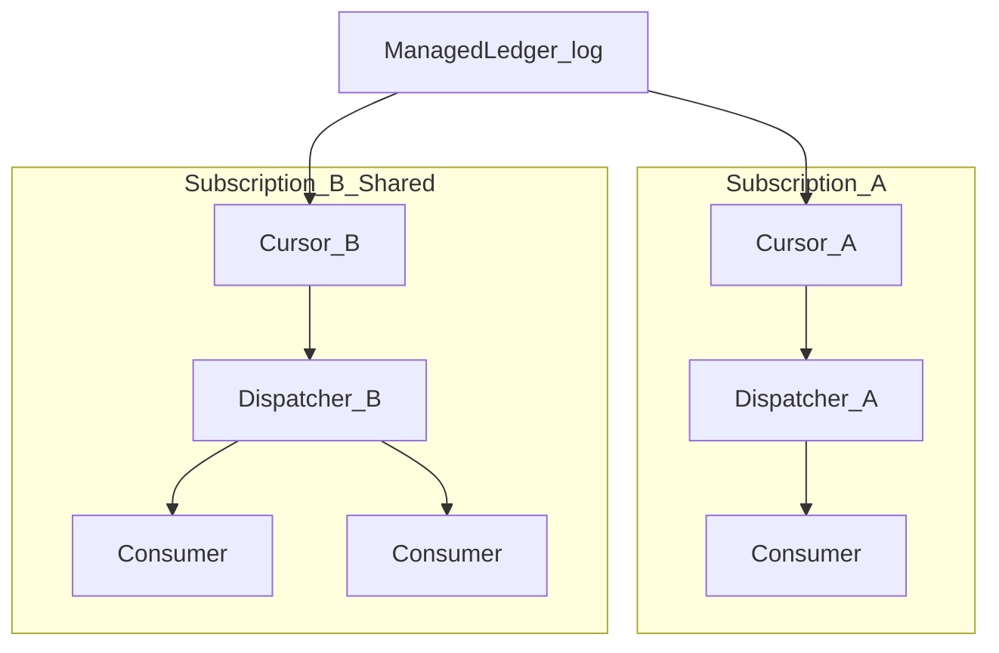
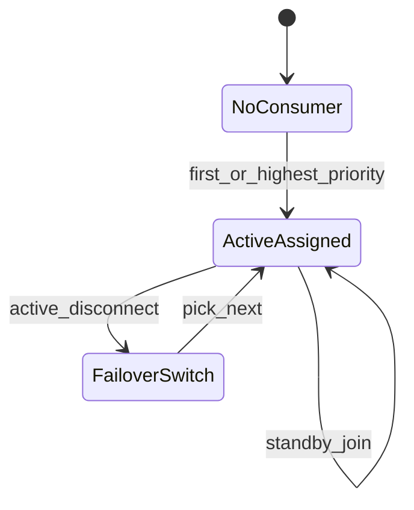
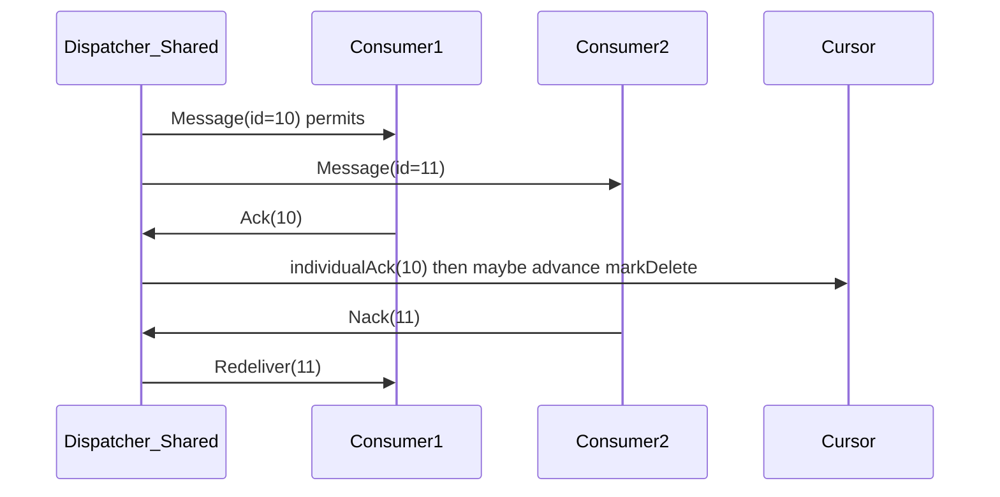
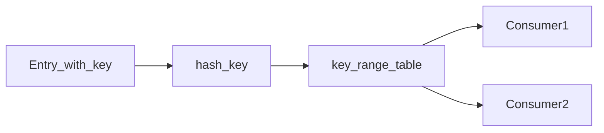

# 消费分发设计：常规消息分发模式

通则：[00-principles.md](./00-principles.md)。游标细节：[04-cursor-subscription.md](./04-cursor-subscription.md)。背压：[08-client-backpressure.md](./08-client-backpressure.md)。

## 0. 为何合理

| 问 | 答 |
|---|---|
| 问题 | 业务要 pub-sub / 队列 / 主备 / 按 key 有序，但不应四套存储 |
| 选型 | 同一 ManagedLedger + 多 subscription + Dispatcher 四模式 |
| 放弃 | 每模式一份消息副本；Shared 用 cumulative 跳洞 |
| 代价 | Shared/Key_Shared 实现与位点复杂度（M3） |
| 验收 | 18 各模式表；Shared Cas 禁跳 individualAcks 空洞 |

## 1. 目标

在 **同一套日志（ManagedLedger）** 上支持业界常规分发模式，而不是为每种模式单独存一份消息：

| 业务说法 | 本系统机制 |
|---|---|
| 发布订阅（多订阅组各收全量） | 同一 topic **多个 subscription**，各组独立 cursor |
| 点对点 / 竞争队列 | **Shared** 订阅：多 Consumer 抢同一 cursor |
| 单消费者独占 | **Exclusive** |
| 主备消费 | **Failover** |
| 按 key 有序并行 | **Key_Shared** |
| 分区内全局有序 | 单分区 + Exclusive/Failover；或 Key_Shared 单 key |

**已定**：四种订阅类型均为一等能力；实现分期，但 **Dispatcher 架构按四模式设计**，避免 Shared 时推翻。

## 2. 总览架构



- **Topic / Partition**：一份日志。  
- **Subscription**：一组消费语义 + **一条权威 Cursor**（Metadata）。  
- **Dispatcher**：Owner Broker 内存组件，按类型把 entry 派给挂在该 sub 上的 Consumer。  
- **Consumer**：连接 + `Flow(permits)` 背压。

## 3. 四种模式详设

### 3.1 Exclusive（独占）

| 项 | 约定 |
|---|---|
| 消费者数 | 仅 1；第二个 Subscribe → 拒 |
| 顺序 | 该分区日志全局顺序投递 |
| Ack | **Cumulative**（可个别实现成对最新位点 cumulative） |
| 位点 | 单 cursor；markDelete 前移 |
| 故障 | Consumer 断 → 等重连；Broker 切主 → 新主从 CursorStore 续 |

适用：严格单活处理、简单流水线。

### 3.2 Failover（主备）

| 项 | 约定 |
|---|---|
| 消费者数 | ≥1；仅 **active** 收消息，其余 standby |
| Active 选举 | 连接顺序 / 显式 priority（数值小优先）；Owner 内存维护 |
| 顺序 | 与 Exclusive 相同（全局有序） |
| Ack | Cumulative |
| 故障 | Active 断 → 选下一 standby，从同一 cursor 续；未 ack 重投 |

适用：有序 + 消费端 HA。



### 3.3 Shared（共享 / 竞争队列）

| 项 | 约定 |
|---|---|
| 消费者数 | ≥1，均可收 |
| 分发策略 | 默认 **轮询**（尊重各 Consumer permits）；可选最少未确认优先 |
| 顺序 | **无全局顺序**；同消息只给一个 Consumer |
| Ack | **Individual**（必须）；禁止 cumulative |
| 位点 | 单 cursor：`markDelete` + `individualAcks` 空洞；连续前缀合并 |
| 重投 | Nack / ackTimeout → 可给**另一** Consumer |
| 故障 | Consumer 断 → 其未 ack 进入 pending 重投队列 |

适用：任务队列、水平扩消费能力。



### 3.4 Key_Shared（按 Key 粘性）

| 项 | 约定 |
|---|---|
| 消费者数 | ≥1 |
| 路由 | `hash(orderingKey or partitionKey) → consumer`（一致性哈希或范围） |
| 顺序 | **同 key 有序**；跨 key 可并行 |
| Ack | Individual |
| 生产约束 | **禁止默认乱序 batch**；须关闭 batch 或 **KEY_BASED batching** |
| 再均衡 | Consumer 增减 → 部分 key 迁移；迁移期该 key **暂停投递**直到旧 Consumer 未确认清空或超时（防双投乱序） |

适用：按用户/订单 ID 有序处理且要并行。



## 4. Dispatcher 内部结构

```text
Dispatcher {
  subscriptionName, mode
  consumers: map[consumerId]→{ permits, inflight, priority, assignedKeyRanges? }
  cursor: CursorHandle          // 权威刷盘走 CursorStore
  readPos: Position             // 下一条待读
  redelivery: Queue/PriorityQ   // Shared/KeyShared nack/timeout
  keyRouter: KeySharedRouter?   // 仅 Key_Shared
}
```

### 4.1 统一调度循环（概念）

```text
loop:
  if redelivery not empty: prefer redelivery (respect mode routing)
  else if any consumer has permits:
    read batch from ManagedLedger at readPos (≤ LAC)
    for each entry:
      target = selectConsumer(mode, entry)
      if target == nil: break or skip (Key_Shared blocked key)
      send if target.permits > 0 else hold
      target.permits--; target.inflight++
      readPos++
  block on Flow / Ack / attach
```

### 4.2 selectConsumer

| mode | 规则 |
|---|---|
| Exclusive | 唯一 consumer |
| Failover | active consumer |
| Shared | round-robin among permits>0 |
| Key_Shared | router(key)；若该 key 在迁移封锁集则不投 |

## 5. Ack / 重投 / 死信（跨模式）

| 机制 | Exclusive/Failover | Shared / Key_Shared |
|---|---|---|
| Cumulative ack | 支持 | **禁止** |
| Individual ack | 可选（实现可只 cumulative） | **必须** |
| Nack | 可致乱序（有序模式慎用） | 进入 redelivery |
| ackTimeout | 未确认重投 | 同左 |
| DLQ / Retry letter | M2+；达最大重投次数后转发旁路 topic | 同左 |

**Cursor 刷盘**：Shared 下 individual 更频繁 → **合并写 + 按 ledger 拆 AckSet**（防 Meta 膨胀），见 04 / PIP-81 思路。  
**洞安全（已定）**：markDelete 只升到「individual 连续前缀」；Meta Cas 拒跳洞；见 [04](./04-cursor-subscription.md) §7.4。

## 6. 与「常规模式」对照表

| 用户期望 | 配置建议 |
|---|---|
| 广播给多组业务 | 多 subscription 名（每组 Exclusive/Failover/Shared 自选） |
| 一组内负载均衡 | 一 subscription + Shared |
| 一组内主备 | Failover |
| 严格全局顺序 | 单分区 + Exclusive/Failover；关乱序 batch |
| 按用户顺序 | Key_Shared + orderingKey；生产 KEY_BASED batch |
| 多分区扩展吞吐 | Partitioned topic；每分区独立 Dispatcher |

## 7. 故障与自愈

| 故障 | 行为 |
|---|---|
| Consumer 断（Shared） | 未 ack → redelivery 给他人 |
| Consumer 断（Key_Shared） | 其 key 范围改派；先等未确认或超时 |
| Active 断（Failover） | 切 standby，同 cursor |
| Broker 切主 | 新主重建 Dispatcher；从 CursorStore 恢复；inflight 全重投（at-least-once） |
| 慢消费者 | permits=0 不再派；Shared 不影响他人 |

## 8. 扩容

- **加 Consumer（Shared/Key_Shared）**：瞬时再均衡；吞吐↑。  
- **加分区**：逻辑并行↑；与订阅模式正交。  
- **加 Broker**：随 bundle 迁走整个 Dispatcher 内存态；cursor 仍在 Meta。

## 9. 实现分期（与总计划对齐）

| 阶段 | 分发能力 |
|---|---|
| **M1** | Exclusive + Cumulative + permits |
| **M2** | Failover + Nack/ackTimeout + DLQ 雏形；SDK 重试 |
| **M3** | **Shared + Key_Shared** + individual ack 完整 + key 迁移封锁 |

四种模式 **全部交付**；M1/M2 的 Dispatcher 预留 `mode`，按里程碑填齐，不从范围删除。

## 10. 不变量

1. 同一 subscription 下，同一 MessageID **成功投递语义**：Shared/Key_Shared 未 ack 前可重投；ack 后不再投（正常路径）。  
2. 多 subscription 互不影响 cursor。  
3. Key_Shared：同 key 不会并发投给两个 Consumer（迁移封锁期除外的双投禁止）。  
4. 分发不写消息体；只写 CursorStore（合并）。  

## 11. 验收

1. 两 subscription 同时消费，各自独立位点。  
2. Shared 三 Consumer，消息无重复 ack 成功；杀其一，未 ack 被另一人收到。  
3. Failover 杀 active，standby 续上且有序。  
4. Key_Shared：同 key 顺序；扩 Consumer 后无同 key 并行双处理（封锁有效）。  
5. 切主后无丢确认前缀；允许未 ack 重复。  
