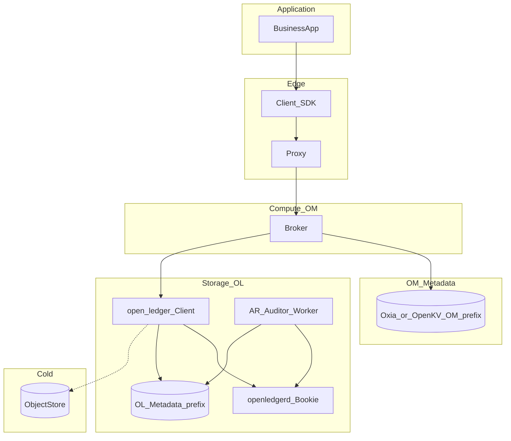

# 组件角色与职能（架构权威）

总览图：[../architecture.md](../architecture.md) §7；流程总册：[13](./13-flows-and-diagrams.md)；OM↔OL 权责：[19](./19-open-ledger-integration.md)。

**目的**：把集群里**每一个角色**的职能写成可验收合同——做什么、不做什么、权威状态在哪、与谁协作。新增组件必须先在本文挂号。  
**合理性**：「为何存在 / 放弃方案」摘要见 [37 §7](./37-design-rationale.md)；本节表格为职能合同，新增角色须同时更新 37。

---

## 0. 分层一览



| 层 | 角色（摘要） |
|---|---|
| 应用 | 业务进程：只依赖 SDK/用户文档 |
| 边缘 | Client SDK、Proxy |
| 计算 | Broker 及其内部服务（Owner / ML / Dispatcher…） |
| OM Meta | Ownership / LedgerIndex / Cursor / Node / Schema… |
| 存储 | open-ledger Client、Bookie、AR、OL Meta |
| 冷层 | 对象存储（仅 CLOSED offload） |
| 控制/运维面 | Admin、LoadManager、对账任务、运维工具 |

---

## 1. 边缘与客户端

### 1.1 Client SDK

| | |
|---|---|
| **职能** | Connect/Lookup；Produce/Consume/Ack；默认可重试；可选幂等；Flow 背压 |
| **做** | 持有 Proxy（或调试直连）URL；未 Receipt 当不确定；NotOwner → Lookup |
| **不做** | 解析 Bundle epoch / Bookie 列表 / Orphan；当集群运维面 |
| **权威状态** | 无（本地 pending/permits 可丢） |
| **协作** | → Proxy 或 Broker；错误语义见 [21](./21-wire-protocol.md)、[33](./33-customer-usage.md) |

### 1.2 Proxy

| | |
|---|---|
| **职能** | 生产默认统一入口；Lookup 缓存；帧转发到 Owner |
| **做** | TLS/鉴权终结或透传；限长校验；Owner 变更时清缓存重 Lookup |
| **不做** | 持久消息/cursor；赋序；改 `sequence_id`/`request_id`；替代 Bookie |
| **权威状态** | 无（缓存可丢） |
| **协作** | Client ↔ Owner；读 OM Ownership（[14](./14-proxy.md)） |

### 1.3 业务应用（Customer）

| | |
|---|---|
| **职能** | 业务收发；按用户文档集成 |
| **不做** | 依赖内部 Admin/Meta 键当业务逻辑 |
| **文档** | [../user/](../user/README.md) |

---

## 2. Broker（计算面）— 进程级

| | |
|---|---|
| **职能** | 无消息权威盘的服务节点：持有 bundle ownership，赋序写、分发读 |
| **做** | 注册 NodeStore；Acquire/Unload；服务 Produce/Consume；调 OL Client；刷 Cursor/Index |
| **不做** | 本地消息 WAL；写 OL LedgerMeta；实现 AR；跨 OM+OL 单 CAS |
| **生命周期** | Starting → Registered → Serving → Draining → Stopped（[09](./09-broker-lifecycle.md)） |
| **角色变体** | **Owner（Primary）** / **Standby（Hot）** / 无主空闲节点 |

### 2.1 Owner（Primary）

| | |
|---|---|
| **职能** | 某 bundle **唯一**成功写者与分发权威运行时 |
| **做** | Append→Qa 后 Receipt；Dispatcher 推送；续约 lease；滚本三步；刷 cursor |
| **不做** | Ready 前对外成功写；与另一 Primary 并存写成功 |
| **权威** | 运行时软状态；持久靠 OM Meta + OL |

### 2.2 Standby（Warm）

| | |
|---|---|
| **职能** | 预热软状态，缩短崩溃窗；**不**对外成功写 |
| **做** | 收 Primary 软状态流；可选只读预取；探测后 Promote（≠等满 TTL） |
| **不做** | 省略 Fence；`max(本地, Meta)` 覆盖 CursorStore |
| **细章** | [16](./16-warm-standby.md)、[26](./26-standby-wire.md) |

---

## 3. Broker 内部角色（逻辑组件）

下列均在 **Broker 进程内**；权威持久仍外置。

| 角色 | 职能 | 做 | 不做 | 权威/状态 |
|---|---|---|---|---|
| **LookupService** | 回答 topic/bundle → owner | 读 OwnershipStore；可触发空闲 Acquire（策略定） | 单独「分配」绕过 CAS | 读 OM |
| **BrokerAPI / 协议层** | 解帧、鉴权、校验 epoch | 拒绝非 Owner 写；映射错误码 | 存消息 | 无 |
| **OwnershipService** | bundle 租约与 epoch | TryAcquire / Renew / Unload / Promote CAS | 搬账本字节、改 cursor | OwnershipStore |
| **TopicManager** | topic 运行时装配 | 懒 Load ML+Dispatcher+Cursor；Unload 拆掉 | 存储复制 | 内存 |
| **ManagedLedger** | 逻辑日志编排 | 赋序 entryId；滚本；调 OL Client；Cas LedgerIndex | 写 LedgerMeta；跑 AR | 链在 LedgerIndex；字节在 OL |
| **open-ledger Client（进程内库）** | 存储 RPC 门面 | Create/Append/Fence/Recover/Close/Read/Offload/MarkOrphan | 业务 Ownership/Cursor | 经其写 OL Meta |
| **CursorService** | 订阅位点 | Create/Get；Ack 合并；CasAdvance；Unload 强制刷 | 消息体；Standby 覆盖权威 | CursorStore |
| **Dispatcher** | 按模式选 Consumer | Exclusive/Failover/Shared/Key_Shared；permits；重投队列 | 持久化位点（交给 CursorService） | 内存 |
| **EntryCache** | 热读加速 | tailing 命中 | 当权威耐久 | 可丢 |
| **IdempotencyTracker** | 生产去重 | M2 内存窗；M3 刷 OM idem 表 | 用 entryId 跨滚本去重 | M2 内存；M3 OM |
| **LoadManager** | 负载均衡建议/半自动迁 | 密度告警；建议 Unload；M2 半自动 | 搬历史 ledger | 读 Node/Ownership |
| **ReconcileWorker**（可独立） | 双 Meta 对账 | 导出 Index↔OL；告警；触发 MarkOrphan | 抽样删 | 只读+受限写 |

---

## 4. open-message Metadata 角色

后端：Oxia（默认）或 OpenKV；**前缀** `/open-message/...`。API：分片 KV + Cas。

| Store / 角色 | 职能 | 谁写 | 不做 |
|---|---|---|---|
| **OwnershipStore** | 谁是 Primary/Standby、epoch、租约 | OwnershipService | 存消息 |
| **LedgerIndex** | topic→ledger **id 链**、openLedgerId | ManagedLedger | 存 ensemble/OffloadLocation/payload |
| **CursorStore** | 订阅 markDelete + individualAcks | CursorService | 消息体 |
| **BrokerNodeStore** | Broker 注册、心跳、标签、隔离组 | Broker | Bookie 注册 |
| **SchemaStore** | Schema 版本与兼容策略 | Admin/Broker | 消息字节 |
| **RoutingTable** | Meta 分片路由世代 | Meta 协调/运维 | 业务数据 |
| **IdempotencyStore**（M3） | producer 去重窗摘要 | IdempotencyTracker | M1/M2 替代品 |

**Metadata 服务进程本身**：提供 Cas/Get/Watch；**不**解释业务语义。

---

## 5. open-ledger 角色（存储面）

前缀 `/open-ledger/...`（可同集群异前缀）。权责总表：[19](./19-open-ledger-integration.md)。

| 角色 | 职能 | 做 | 不做 |
|---|---|---|---|
| **openledgerd（Bookie）** | 存 entry 字节与 Journal | AddEntry/Read；注册心跳；fence 响应 | 解释 topic/订阅；写 OM Meta |
| **OL Metadata** | LedgerMeta、registry、AR 队列 | 被 Client/AR/Bookie Cas | 被 Broker 直接写业务键 |
| **OL Client** | 见 §3；算法权威 Fence/Recover | 发号 ledgerId；选 ensemble | 业务 Cursor |
| **Auditor** | 发现 underreplicated | 入队延迟任务 | Broker 内再实现一套 |
| **Replicator Worker** | 补副本 | recoveryAdd；更新 fragment ensemble | 改 OM LedgerIndex |
| **Offload Worker**（可与 Client 同路径） | CLOSED → 对象存储 | 写 OffloadLocation；校验后删热 | 热路径主写对象存储 |

---

## 6. 控制面 / 运维面角色

| 角色 | 职能 | 做 | 不做 |
|---|---|---|---|
| **Admin API** | 人/CI 变更入口 | Unload、建删 topic、策略、危险删（二次确认） | 绕过 Ownership CAS「只改本地图」宣称迁主成功（[25](./25-admin-api.md)） |
| **Ops / Runbook 执行者** | 安装部署扩缩演练恢复 | 按 [32](./32-operations.md) / [../ops/](../ops/README.md) | 跳过 Fence；抽样删 orphan |
| **对账任务** | 见 ReconcileWorker | C13–C15 / 指标 | 单面恢复当完整 DR |
| **对象存储** | 冷副本 | 存 offload 对象 | 热 Produce 主路径 |

---

## 7. 协作矩阵（谁找谁）

| 从 → 到 | 典型调用 |
|---|---|
| SDK → Proxy | Connect / Send / Subscribe / Ack |
| Proxy → OwnershipStore | Lookup |
| Proxy → Owner Broker | 转发帧 |
| Owner → OL Client | Append / Recover / Create / Read |
| OL Client → Bookie | AddEntry / Fence / Read |
| OL Client → OL Meta | LedgerMeta CAS |
| ManagedLedger → LedgerIndex | 挂链 Cas |
| CursorService → CursorStore | CasAdvance |
| Standby → Primary | 软状态流（[26](./26-standby-wire.md)） |
| AR → Bookie / OL Meta | 补副本 |
| Admin → OwnershipService | Unload 等 |

禁止边：

```text
Broker --写--> OL LedgerMeta keys（必须经 OL Client）
Broker --实现--> AutoRecovery
Proxy  --赋序/落盘--> 消息
Client --依赖--> Bookie 地址列表（生产）
```

---

## 8. 按四目标看角色贡献

| 目标 | 关键角色 |
|---|---|
| 高可用 | Ownership、Fence/Recover、Standby、AR、Proxy、SDK 重试 |
| 高并发 | 多 Broker Owner、Meta 分片、多 Bookie、Dispatcher Shared、LoadManager |
| 强一致 | Ownership 线性化、ManagedLedger 单写、OL Recover、Qa Receipt |
| 用户无感 | Proxy、SDK、Drain/Unload、幂等、用户文档 |

细述：[34](./34-architecture-goals.md)。

---

## 9. 挂号规则

```text
[ ] 新组件/角色已写入本文表格（做/不做/权威/协作）
[ ] architecture §7 摘要已同步或指向本文
[ ] 若有新端到端路径 → 13 目录表挂号
[ ] OM vs OL 边界变更 → 更新 19 并审计传播
```

---

## 10. 相关文档

| 文档 | 用途 |
|---|---|
| [../architecture.md](../architecture.md) §7 | 主文档摘要表 |
| [19](./19-open-ledger-integration.md) | OM/OL 权责 |
| [09](./09-broker-lifecycle.md) | Broker/Bundle 生命周期 |
| [14](./14-proxy.md) / [16](./16-warm-standby.md) | Proxy / Standby |
| [02](./02-metadata.md) | OM Store 形态 |
| [13](./13-flows-and-diagrams.md) | 角色如何串成流程 |
| [25](./25-admin-api.md) | Admin |
| [32](./32-operations.md) / [33](./33-customer-usage.md) | 运维角色 vs 客户角色 |
